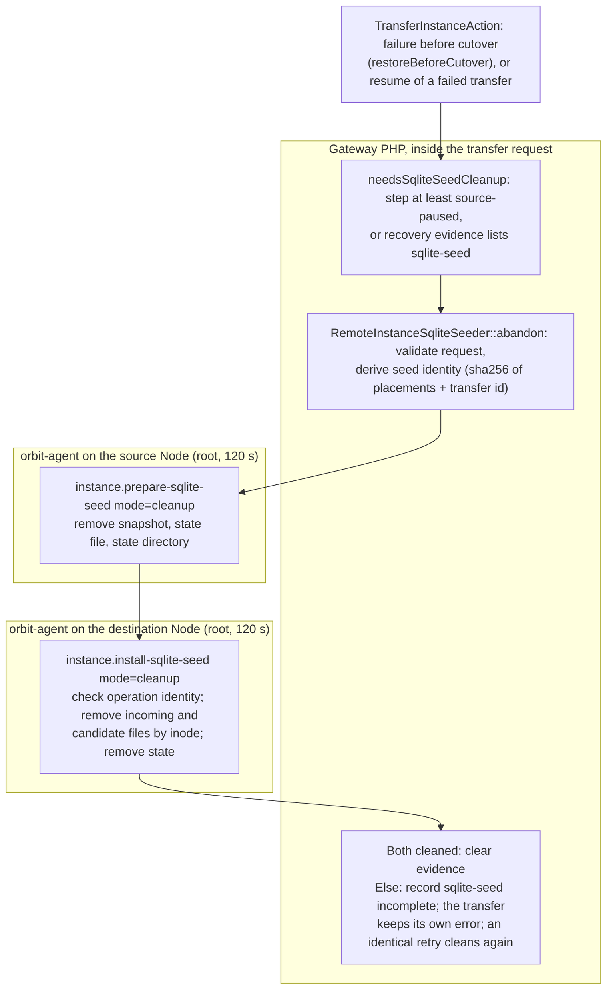
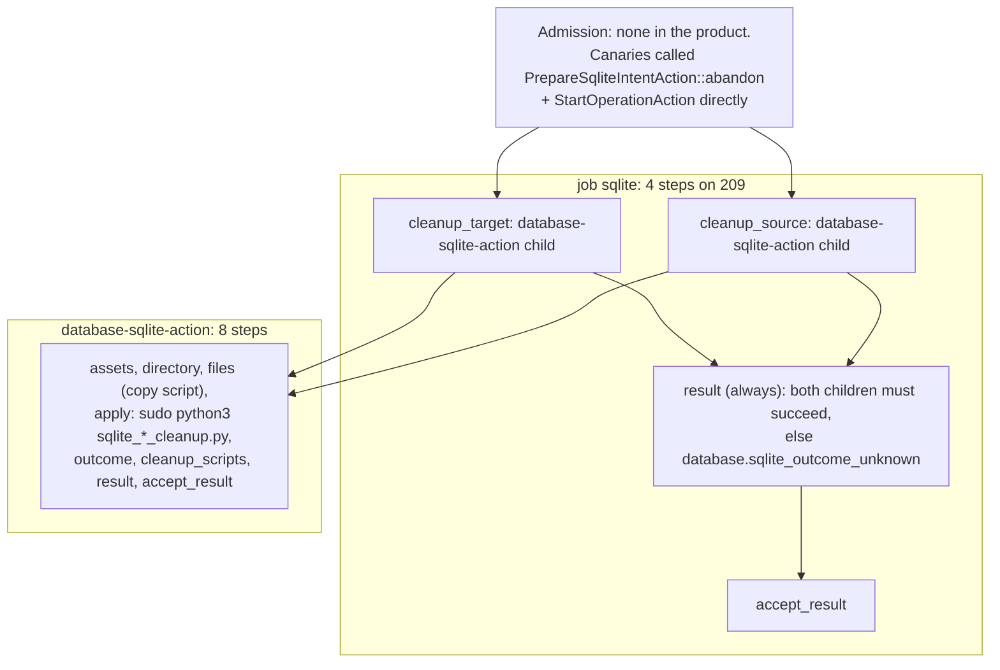

# SQLite seed abandon: legacy and Swamp flows

**Deleted by [#2341](https://github.com/hardimpactdev/orbit/pull/2341) (`02eafcec69`, 1 November).** The kind, its workflow, its grant, its cleanup script and `PrepareSqliteIntentAction::abandon` are gone from main. This page stays as the record of why. Links to Swamp files point at `a3545d517e`, the last commit before the deletion.

`database.sqlite_seed_abandon` cleaned up a SQLite seed that a failed development transfer left behind. In legacy it was one step of the transfer rollback, never a command of its own. Before #2341 it was a registered kind that nothing in the product admitted: no route, CLI, SDK, MCP tool or Gateway action called it. Transfer and clone both refuse SQLite, so no live path creates a seed that would need cleaning. Its two runs were operator canaries, and both failed. So it was deleted, not rebuilt. Re-add the cleanup inside the transfer rebuild if SQLite transfer returns.

Sources:

- Legacy: `RemoteInstanceSqliteSeeder::abandon`, called from `TransferInstanceAction`, at [`3c897e768a`](https://github.com/hardimpactdev/orbit/tree/3c897e768a). `c21bbc4605` (2 October) added the abandon step to transfer.
- Switches: `f7aa9864ef` (#1613, 29 October) added the kind on the Kit path; `6b71cd0168` (#1598) deleted the seeder; `8ea4d2f77e` (#1947, 31 October) added `PrepareSqliteIntentAction`; `6a6d46ead7` (#1965) made native transfer refuse SQLite.
- Swamp: [`workflow-operation-database-sqlite-seed-abandon.yaml`](https://github.com/hardimpactdev/orbit/blob/a3545d517e/swamp/workflows/workflow-operation-database-sqlite-seed-abandon.yaml) and its child `database-sqlite-action`, last changed by #2217 (`526bee7100`) and deleted by #2341.
- Runs: Gateway Operation records and the lane 10 evidence in `~/swamp-execution/evidence/database-sqlite-native/`.

## Legacy flow

Abandon ran inside a transfer, in the Gateway request, when the transfer failed before cutover. It cleaned the snapshot on the source and the incoming and candidate files on the destination. It never removed a database that was already installed.

| Step | Action | Actor | File at `3c897e768a` |
| --- | --- | --- | --- |
| Gate | Clean up only when the transfer reached `source-paused`, or evidence lists `sqlite-seed` | Gateway | `apps/gateway/app/Actions/Instances/TransferInstanceAction.php` (`needsSqliteSeedCleanup`) |
| Identity | Validate the request; derive the seed identity and state paths | Gateway | `Infrastructure/Instances/RemoteInstanceSqliteSeeder.php` (`abandon`, `seedIdentity`) |
| Source | Remove the snapshot and its state | agent | `instance.prepare-sqlite-seed` (`apps/agent/src/commands/sqlite_seed.rs`) |
| Destination | Remove incoming and candidate files by inode; keep an installed database | agent | `instance.install-sqlite-seed` (`sqlite_seed.rs`) |
| Outcome | Both cleaned, or record `sqlite-seed` incomplete; the transfer keeps its original error, and an identical retry repeats the cleanup (`instance.transfer_failed` while the rollback stays pending) | Gateway | `TransferInstanceAction.php` (`restoreBeforeCutover`) |

Abandon returned a boolean, never its own code. The agent's codes were `instance.sqlite_seed_refused`, `instance.sqlite_seed_failed` and `instance.sqlite_seed_unconfirmed`. Legacy clone seeded SQLite but never abandoned a seed.

Legacy tests, at `3c897e768a`: `apps/gateway/tests/Feature/Infrastructure/Instances/RemoteInstanceSqliteSeederTest.php` (8, one for abandon), six SQLite seed cases in `apps/gateway/tests/Feature/Api/TransferInstanceTest.php`, and `apps/agent/src/commands/sqlite_seed_tests.rs` (8).

## Swamp flow before deletion

`PrepareSqliteIntentAction::abandon` built the intent from a recorded `database.sqlite_seed` Operation. It refused anything but a development transfer seed of the same Instance with `sqlite.seed_abandon_forbidden`. No product code called it. The run had one job of 4 steps on Node 209; two of them started the child `database-sqlite-action`, which had 8 steps and reached the Node over `@swamp/ssh`.

Differences from legacy:

- Target and source cleanups ran in parallel; legacy cleaned the source first.
- A clean refusal from a cleanup script failed the child's `accept_result`, so the parent reported `database.sqlite_outcome_unknown` instead of the script's code.
- The run set no budget of its own, so the 300 s default applied.

## Mapping

Legacy step to Swamp steps before deletion.

| Legacy step | Swamp before deletion | Steps |
| --- | --- | --- |
| Gate inside transfer | none: no caller | 0 |
| Seed identity | `PrepareSqliteIntentAction::abandon` (unreferenced) | 0 |
| Source cleanup, 1 agent call | `cleanup_source` child | 1 + 8 |
| Destination cleanup, 1 agent call | `cleanup_target` child | 1 + 8 |
| Outcome | `result`, `accept_result`, `DatabaseSqliteProjection` | 2 |

## Times and failures

Both runs were operator canaries on the synthetic Instance 2000002217. The source was on Node 9 under `/home/nckrtl/sandbox/db-native-canary-20261031-a`; the target was on Node 209 under `/home/orbit/sandbox/database-sqlite-2217-20261101` (and a `-v2` variant).

| Operation | Shape | Result | Time | Cause |
| --- | --- | --- | --- | --- |
| 6599 | #2217 | `database.sqlite_outcome_unknown` | 2 min 44 s | `cleanup_target` failed: Node 209 tried SSH to itself as `orbit` and was refused (`Permission denied (publickey)`); `cleanup_source` succeeded. |
| 6624 | #2217 | `operation.native_failed` | 17 s | The worker-frame outage of 1 November (B7): an unbounded observation read exceeded the 64 MiB worker frame, so 209 dispatches failed. |

It never succeeded.

## Deletion instead of rebuild

PLAN F9 rebuilds a kind from its legacy sequence when a supported caller needs it. This kind had none:

- No HTTP route, CLI command, SDK request, MCP tool or web path admitted it.
- Nothing in `apps/gateway/app` called `PrepareSqliteIntentAction`. Only `InstanceSqliteSeedIntentTest` and `PrepareSqliteIntentActionTest` did.
- Its only legacy purpose was the pre-cutover rollback of a SQLite transfer.
- Native transfer refuses `sqlite_source_path` (`NativeInstanceTransferIntent::assertSupported`). Native clone refuses SQLite too. No live path can create a seed that needs abandoning.

#2341 deleted these parts together.

| Area | Deleted |
| --- | --- |
| Gateway | The `database.sqlite_seed_abandon` entry in `apps/gateway/app/Domain/DatabaseServers/direct-operations.php`, and `PrepareSqliteIntentAction::abandon` |
| Workflow | `swamp/workflows/workflow-operation-database-sqlite-seed-abandon.yaml` and its grant in `swamp/config/gateway-workflow-grants.json` |
| Behavior | In `database-server-commands/sqlite_assets.ts`: the abandon kind in the `Kind` enum, the abandon branch, its entry in the `absent` backend list, and the `target_cleanup` action that only abandon used (export and seed keep `source_cleanup`) |
| Child workflow | The abandon kind and the `target_cleanup` action in `workflow-database-sqlite-action.yaml` |
| Script | `scripts/sqlite_target_cleanup.py` and its line in `database-server-commands/manifest.yaml` |
| Tests | The abandon cases in `PrepareSqliteIntentActionTest.php`, the `database.sqlite_seed_abandon` dataset entries in `InstanceSqliteSeedIntentTest.php` and `DatabaseSqliteProjectionTest.php`, and the abandon runs in `sqlite_native_test.py` |

`test_target_cleanup_…` in `sqlite_scripts_test.py` stays. It tests the seed target cleanup mode, which `sqlite_seed_common.py` still supports.

`PrepareSqliteIntentAction::seed` has no product caller either, so `database.sqlite_seed` is canary-only as well. #2341 kept it; it is still registered on main.

If the transfer rebuild restores SQLite, put the cleanup back as a phase of transfer recovery, as legacy had it. These edge cases come with it:

- Cleanup repeats safely: an absent state counts as cleaned, and the source also requires the snapshot to be gone.
- Files are removed only when their recorded inode matches.
- A state with another operation identity is refused.
- An installed destination database is never deleted.
- A lost success reply is retried by the identical request; a partial failure records `sqlite-seed` as incomplete and blocks a new capture until a retry confirms.
- Clean the source before the destination.

No F13 fixture is drafted: the F13 format proves a kind through a public CLI call, and no CLI call admits this kind. #2341 proved itself by the kind's absence and the remaining SQLite tests.
