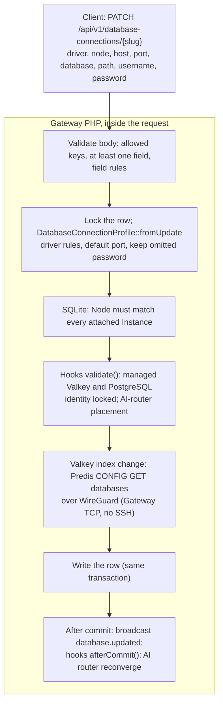
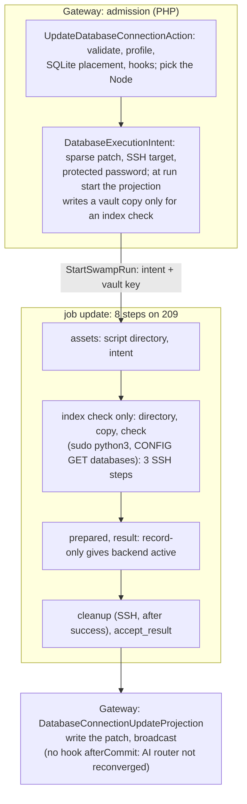

# Database update: legacy and Swamp flows

`orbit database:update` changes a registered Database connection. Legacy did it as one Gateway write inside the request and answered `200`. Its remote calls were a Valkey `CONFIG GET databases` from the Gateway when the index changed, and an AI-router reconverge when the connection was the AI-router cache. On main every update is an Operation: an 8-step run on Node 209 that reaches the server Node over `@swamp/ssh` only to check a Valkey index. Its only live run, operation 5980, failed after 6 minutes on an earlier shape.

The port also lost the AI-router reconverge that legacy ran after a successful update. The kind has supported callers, so it needs a rebuild. This page is the map for the F9 rebuild of `database.update`.

Sources:

- Legacy: `UpdateDatabaseConnectionAction` at [`bdf6ed3684`](https://github.com/hardimpactdev/orbit/tree/bdf6ed3684), the parent of the switch; the action last changed in `a503428f11` (18 October).
- Switch: `8ea4d2f77e` (#1947, 31 October) made the PATCH answer `202` with an Operation. Its workflow came from orbit-swamp#402 (`c2b739fd89`).
- #2152 (`ca3a0ce01f`) removed the failure step.
- #2183 (`bb1e265740`, 1 November) moved the run to Node 209 with `@swamp/ssh` and a vault copy of the password.
- Swamp: [`workflow-operation-database-connection-update.yaml`](https://github.com/hardimpactdev/orbit/blob/main/swamp/workflows/workflow-operation-database-connection-update.yaml) on main.

## Supported callers on main

These callers admit `database.update` today.

- CLI: `orbit database:update <slug>` (`apps/cli/app/Commands/Database/UpdateDatabaseConnectionCommand.php`), which follows the Operation.
- PHP SDK: `UpdateDatabaseConnectionRequest` (PATCH).
- MCP: the `database-update` tool, generated from the OpenAPI document.
- Documentation: `docs/cli/database.mdx`, `docs/reference/database-connections.md`, `docs/reference/database-servers.md`, and the PostgreSQL repointing runbook in `docs/reference/postgresql-migration.md`.

The web app does not call it. No other Gateway code, workflow or policy admits it.

## Legacy flow

`PATCH /api/v1/database-connections/{slug}` ran `UpdateDatabaseConnectionAction` inside the request and answered `200` with the connection.



| Step | Action | Actor | File at `bdf6ed3684` |
| --- | --- | --- | --- |
| Validate | Allowed keys, at least one field, field rules | Gateway | `apps/gateway/app/Http/Requests/DatabaseConnections/UpdateDatabaseConnectionRequest.php` |
| Normalize | Lock the row; driver-dependent profile; default port; keep an omitted password | Gateway | `Actions/DatabaseConnections/UpdateDatabaseConnectionAction.php`, `Domain/DatabaseConnections/DatabaseConnectionProfile.php` |
| SQLite placement | The connection's Node must match every attached Instance | Gateway | `UpdateDatabaseConnectionAction.php` |
| Hooks | Managed Valkey and PostgreSQL identity, credentials and locale locked; AI-router placement | Gateway | `Domain/DatabaseServers/ValkeyConnectionUpdateHook.php`, `PostgresConnectionUpdateHook.php`, `apps/gateway/extensions/ai-router/src/Actions/ReconvergeAiRouterConnectionAction.php` |
| Valkey index | `CONFIG GET databases` to the server Node's WireGuard address | Gateway (Predis TCP) | `Infrastructure/DatabaseServers/PredisValkeyServerAdmin.php` |
| Write | Update the row in the same transaction | Gateway | `UpdateDatabaseConnectionAction.php` |
| After commit | Broadcast; AI-router reconverge (`ConvergeAiRouterAction`, force) | Gateway | `UpdateDatabaseConnectionAction.php`, `ReconvergeAiRouterConnectionAction.php` |

Gateway paths are under `apps/gateway/app/` unless given in full. Legacy ran no general connection test. It made agent calls only for the AI-router cache: the reconverge updated the AI-router Process on its Node. It did not publish to Vault or sync attached Instances' environments; the docs told operators to attach again. A failed reconverge kept the committed row, and the same update could retry it.

Legacy tests for the parity port, at `bdf6ed3684`:

- `apps/gateway/tests/Feature/Actions/DatabaseConnections/DatabaseConnectionHooksTest.php` (7).
- Update cases in `Api/DatabaseConnectionsTest.php`, `Api/AiRouterRoutesTest.php` (4), `Api/DatabaseConnectionAttachmentsTest.php` (2), `Api/ServerDatabasesTest.php`, `Api/ValkeyAclUsersTest.php` (about 3, with a 5-case dataset), `Domain/Broadcasting/DatabaseConnectionRecordEventsTest.php` (1 of 3) and `Infrastructure/DatabaseServers/PredisValkeyServerAdminTest.php`, all under `apps/gateway/tests/Feature/`.
- CLI `DatabaseConnectionCommandsTest.php` and SDK `DatabaseConnectionRequestsTest.php`.

## Swamp flow on main

`UpdateDatabaseConnectionAction` repeats the validation, the SQLite check and the hooks. The Valkey hook now checks only that the index is digits; the range check moved into the run. The action picks the server Node, or the active Gateway Node for an unmanaged connection, else refuses with `database.node_unavailable` (422). It records a `DatabaseExecutionIntent` and answers `202` with an Operation. The run has one job of 8 steps on Node 209.



Guards and skips:

- `directory`, `copy`, `check` and `cleanup` run only when `intent.validate_index` is true. A record-only update runs 4 local steps.
- `cleanup` runs only after a successful result, so a failed index check leaves `/tmp/orbit-database-update-<op>` on the server Node.
- No step sets a timeout; the default run budget of 300 s (#2300) applies.

## Mapping

Legacy step to Swamp steps on main.

| Legacy step | Swamp on main | Steps | Change |
| --- | --- | --- | --- |
| Validate, normalize, SQLite placement, hooks | admission, still in the request | 0 | Valkey range check moved into the run |
| Valkey index (Gateway TCP) | `directory`, `copy`, `check` over SSH | 3 | **1 TCP call → 3 SSH steps** |
| Write | `prepared`, `result`, `accept_result`, then the projection | 3 | a record-only update **now needs a Swamp run** |
| After commit: broadcast | projection | 0 | |
| After commit: AI-router reconverge | none | 0 | **dropped** |
| none | `assets`, `cleanup` | 2 | new |

## Times and failures

One update has run since the switch.

| Operation | Shape | Target | Result | Time |
| --- | --- | --- | --- | --- |
| 5980 | #1947 / orbit-swamp#402, 31 October 10:10Z | connection 47, intent 18 | `operation.native_failed`, result `[]` | 6 min 16 s |

That shape ran a job named `server` on the server Node's own worker (or the Gateway Node's, for an unmanaged connection). Its `apply` step read the Operation, projected `running` and fetched private material from the Gateway over HTTP, then a `failure-apply` step reported failures. "No recorded step" is normal: native runs write no Gateway step receipts. Two plausible causes, neither confirmed: no worker for that Node had the behavior and the run waited, or the `apply` step's Gateway calls failed and the failure path or the later recovery-on-read set `native_failed`. No run budget existed yet. No update has run on the #2183 shape.

Gaps on main:

- The AI-router reconverge after an update is gone. `AiRouterRoutesTest.php` still expects it, and `docs/reference/ai-router.md` still promises it.
- A failed index check leaves its temporary directory on the server Node.
- `host_keys` can be empty for a Node without a recorded host key. How `@swamp/ssh` treats an empty list is unchecked.

## F9 rebuild phases

Legacy is the spec (PLAN F9). Each phase becomes one script file run as one step, in this order. Edge cases are the ones the legacy handled.

### 1. Admit and normalize (Gateway)

Runs on: Gateway, with the connection row locked.

Input checks:

- Body: an object with allowed keys only and at least one field; otherwise 422 on `body`.
- Field types and values (strict integers, driver enum, path pattern): `validation.failed`.
- Driver profile errors, all `validation.failed`:
  - a SQLite path on a network driver;
  - MySQL or PostgreSQL without host, database or username;
  - a missing password when none is stored;
  - Redis without a host;
  - SQLite with host, port or database, or without a path.
Other checks:

- Keep an omitted password; `node_id: null` clears the Node.
- SQLite Node differs from an attached Instance's Node: `database.node_mismatch` (422).
- Managed Valkey or PostgreSQL identity, credential or locale change: `database.server_connection_managed` (409).
- Unknown slug: 404.

### 2. Check the Valkey index (only when it changes)

Runs on: the Valkey server Node, or the Gateway as in legacy.

- Index out of range or not digits: 422 on `database`.
- Server unreachable or the command fails: `database.server_command_failed` (502).
- Remove any temporary files whatever the outcome.

### 3. Write (Gateway)

Runs on: Gateway, one transaction.

- Update the row; concurrent updates stay serialized by the row lock.
- Record Activity with the password redacted.

### 4. After commit (Gateway)

Runs on: Gateway, plus the AI-router Node when the connection is its cache.

- Broadcast `database.updated`.
- Run each hook's `afterCommit()`: the AI router reconverges (`ai_router.cache_invalid`, `ai_router.cache_unplaced`, `ai_router.node_invalid`). A failed reconverge keeps the committed row; the same update retries it.

Only phase 2 touches a Node, and only for a Valkey index change. A record-only update needs no Swamp run, as in legacy. Budget (PLAN F8): legacy finished inside the request; phase 2 is one short command.

## Draft F13 fixture

A draft in the frozen F13 request format, for the `database` topology. It exercises phase 2: a managed Valkey connection changes its index. `--json` on an Operation command prints the final Operation.

```json
{
  "kind": "database.update",
  "workflow": "operation-database-connection-update",
  "topology": "database",
  "budget_seconds": 60,
  "prepare": [
    {"argv": ["orbit", "database:server:create", "proof-vk-${proof.run}", "--node=${topology.database.node_id}", "--driver=redis", "--json"],
     "capture": {"server_operation_id": "$.id"}},
    {"argv": ["orbit", "database:create", "proof-db-${proof.run}", "--server=proof-vk-${proof.run}", "--database=0", "--pattern=proof:*", "--allow=@read", "--allow=@write", "--json"],
     "capture": {"connection_operation_id": "$.id"}}
  ],
  "request": {
    "argv": ["orbit", "database:update", "proof-db-${proof.run}", "--database=1", "--json"],
    "operation": "$.id"
  },
  "expect": {"status": "succeeded", "outputs": {"job": "update", "step": "result", "match": {"exitCode": 0}}}
}
```

The `result` step publishes `{stdout, exitCode}`; the Operation result `{backend: active}` belongs in the parity check, read with `operation:show`.

A second case covers a record-only update: register an unmanaged connection with `database:create proof-pg-${proof.run} --driver=pgsql --host=… --database=… --username=… --password=…`, then `database:update proof-pg-${proof.run} --port=5433`. It should succeed without any SSH step. A third case covers the lost reconverge, once the AI-router extension is in the topology.

Gaps the fixture exposes:

- The `database` topology must give the Gateway a server Node reachable over `@swamp/ssh`, with a recorded host key.
- The record-only case needs a reachable or at least a resolvable PostgreSQL host; legacy did not test the connection, so any host string passes.
