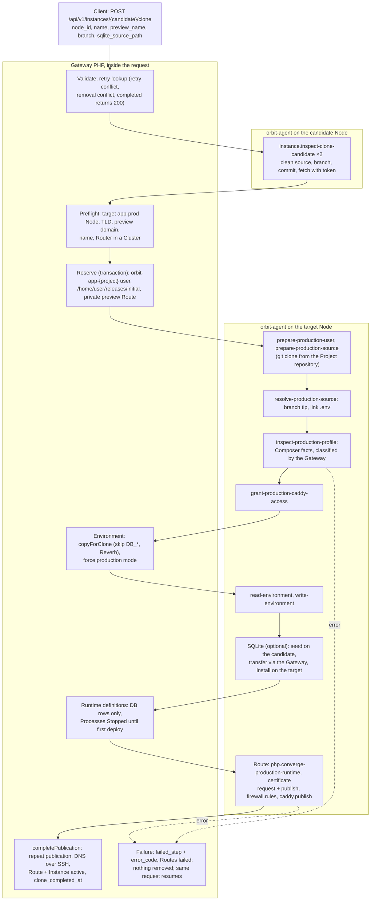
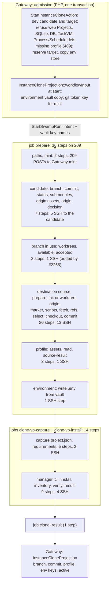

# Instance clone: legacy and Swamp flows

Legacy `instance:clone` turned a development or production candidate into a new **production** Instance on an app-prod Node, inside one API request. It made about 19 agent calls, published a private preview Route, and its longest recorded run took 89 s. On main, clone accepts only a **development** target on an app-dev Node and refuses Routes, SQLite, databases and runtime definitions. It runs 51 steps on Node 209. Its only live run, operation 5930 on an earlier shape, failed at `profile`. This page is the map for the F9 rebuild of `instance.clone`.

Sources:

- Legacy: `CloneInstanceAction` at [`4603475a4c`](https://github.com/hardimpactdev/orbit/tree/4603475a4c). `3c897e768a` (29 October, the squash that carries #1618) moved clone to an admitted Operation.
- Swamp: [`workflow-operation-instance-clone.yaml`](https://github.com/hardimpactdev/orbit/blob/main/swamp/workflows/workflow-operation-instance-clone.yaml) on main, last changed by #2266. Earlier native shapes: #1935 and orbit-swamp#392 (31 October), #2238 (1 November).
- Runs: Gateway Operation records, ADR 0218 and the lane 0d custody handoff.

## Legacy flow

`POST /api/v1/instances/{candidate}/clone` called `CloneInstanceAction` inside the request and answered `201`, or `200` for a completed retry. Each Node action was one orbit-agent command over SSH. Every step saved a `provisioning_step` checkpoint, so an identical request resumed where the last one stopped.

| Phase | Legacy action | Actor | File at `4603475a4c` |
| --- | --- | --- | --- |
| Admission | Validate, retry lookup, branch choice, preflight, reserve Instance and Route | Gateway | `apps/gateway/app/Actions/Instances/CloneInstanceAction.php`, `Http/Requests/Instances/CloneInstanceRequest.php` |
| Candidate | Inspect the candidate twice, before and after reserve | agent, 2 calls | `Infrastructure/Instances/RemoteInstanceCloneCandidateInspector.php`; agent `clone_candidate.rs` |
| Source | Production user, clone from the Project repository, checkout of the branch tip | agent, 3 calls | `Infrastructure/Instances/RemoteProductionInstanceSourceLifecycle.php`; agent `production_home.rs` |
| Profile | Read Composer facts; classify PHP version and framework | agent + Gateway | `RemoteProductionInstanceSourceLifecycle.php` (`inspect-production-profile`), `ComposerSourceClassifier` |
| Environment | Copy the stored values, force production mode, write `.env` | Gateway + agent, 2 calls | `CloneInstanceEnvironmentAction.php`, `InstanceEnvironmentStore::copyForClone` |
| SQLite | Seed the snapshot through the Gateway (optional) | agent, 6 calls + 2 environment | `RemoteInstanceSqliteSeeder.php` |
| Definitions | Capture Project Process and Schedule definitions as records | Gateway | `InstantiateProjectRuntimeDefinitionsAction::captureForClone` |
| Route | PHP-FPM, certificate, firewall, Caddy, then a second pass and DNS | agent + SSH | `NativeProductionRouteProjector.php`, `DnsmasqPrivateDnsManager.php` |
| Finish | Route and Instance active; `clone_completed_at` | Gateway | `CloneInstanceAction::completePublication` |

Gateway paths are under `apps/gateway/app/`; agent paths are under `apps/agent/src/commands/`. Clone selected no release: the first `instance:deploy` chose the code. A clone without a Route (a package Project) became active after the definitions. A typical clone with a Route and PHP made about 19 agent calls and 1 DNS call. SQLite added 8 calls and a Cluster about 10. ADR 0218 recorded 89 s as the longest `instance:clone` request.

Legacy tests for the parity port, at `4603475a4c` under `apps/gateway/tests/Feature/`: `Api/InstanceDatabaseCloneTest.php` (34), `Domain/CloneInstanceTest.php` (20), `Domain/CloneInstanceEnvironmentTest.php` (9), `Api/CloneInstanceTest.php` (7), `Infrastructure/Instances/RemoteInstanceCloneCandidateInspectorTest.php` (7), `Infrastructure/Instances/RemoteInstanceSqliteSeederTest.php` (8), `Infrastructure/Instances/RemoteInstanceSqliteClonerTest.php` (4), `Domain/CloneInstanceEnvironmentWarningsTest.php` (3). CLI: `apps/cli/tests/Feature/Instances/CloneInstanceCommandTest.php` (12). Agent: `clone_candidate_tests.rs` (9), `production_home_tests.rs` (14), `sqlite_seed_tests.rs` (8), `sqlite_transfer_tests.rs` (6).

## Swamp flow on main

`StartInstanceCloneAction` admits the clone in one transaction. On main both the candidate and the target must be development placements on app-dev Nodes, and the target Node needs a stored `apps.path`. It refuses with `operation.kind_unavailable` when the Project serves the web (any Route requirement), when a SQLite source is given, when the candidate has a database attachment, when either Node hosts a TaskVM, or when the Project has Process or Schedule definitions. It refuses a candidate whose stored source profile is not a boolean with `instance.source_profile_missing` (409).

The action reserves the target and copies the candidate's stored environment into the target's store. When the run starts, `InstanceCloneProjection::workflowInput` writes the environment vault copy; the `mint` step fills the git token key. The run has four chained jobs on Node 209. SSH steps reach the candidate Node (5 steps) or the destination Node (22 steps) over `@swamp/ssh`.

Guards and skips:

- Each job depends on the one before it succeeding, so a failure in `prepare` skips the Vite+ jobs and the result step.
- From `source-worktrees` on, each source step skips after the first failed step (#2266).
- `source-worktrees` runs only for a seeded worktree without a retained source. `source-init` and `source-worktree` choose a fresh checkout or a seeded worktree.
- `source-fetch` skips without network or for a retained source; `source-checkout` skips for a retained source.
- The clone runs no Project setup and no deploy steps.

What #2266 (`049d0a4a23`) changed in clone:

- The Gateway mint accepts GitHub's stateless installation tokens, which contain dots (`HttpGitHubApi::scopedRepositoryToken`, regex `[A-Za-z0-9_.-]`). Before, every private clone failed at `mint` with `token_format`.
- Three steps refuse a target branch that another worktree has checked out, before any write: `source-worktrees`, `source-branch-available`, `source-branch-accepted` (`instance.branch_in_use`). Clone went from 48 to 51 steps.
- 23 source steps gained the guard "skip after the first failed step", so a failure stops the chain instead of reading skipped outputs.

## Mapping

Legacy action to Swamp steps on main. "Steps" counts declared steps.

| Phase | Legacy calls | Swamp on main | Steps | Change |
| --- | --- | --- | --- | --- |
| Admission | Gateway, in the request | `StartInstanceCloneAction`, one transaction | 0 | **production target dropped**; Route, SQLite, DB, definitions refused |
| Token | Gateway, passed to the agent | `paths`, `mint` | 2 | |
| Candidate | 2 agent calls | `candidate-branch`, `-commit`, `-status`, `-submodules`, `-origin-assets`, `-origin`, `candidate` | 7 | **2 → 7**; inspected once, no second check |
| Branch in use | none | `source-worktrees`, `source-branch-available`, `source-branch-accepted` | 3 | new (#2266) |
| Source | 3 agent calls | 20 destination source steps, same chain as `instance.create` | 20 | **3 → 20**; dev checkout instead of a production home |
| Profile | 1 agent call + Gateway classifier | `source-profile-assets`, `source-profile-read`, `source-result` | 3 | |
| Environment | Gateway copy + 2 agent calls | admission copies the store; `environment` writes `.env` | 1 | production mode not forced |
| Vite+ | none in clone | `clone-vp-capture` (5), `clone-vp-install` (9) | 14 | new |
| SQLite | 8 calls (optional) | refused | 0 | **dropped** |
| Definitions | Gateway records | refused | 0 | **dropped** |
| Route | about 10 calls + DNS | refused | 0 | **dropped** |
| Finish | Gateway transaction | `result`, then `InstanceCloneProjection` | 1 | |

Totals: legacy about 19 agent calls and 1 DNS call for a routed production clone. Main declares 51 steps (27 SSH) for a development-only clone without a Route.

## Times and failures

Only one clone has run since the switch. Legacy clone ran inside the request and left no Operation records.

| Operation | Shape | Target | Result | Time |
| --- | --- | --- | --- | --- |
| 5930 | #1935 / orbit-swamp#392, about 7 min after merge | Instance 778, production on Node 4, from candidate 777 (`sindresorhus/is`, `node-package`) | `instance.provisioning_failed`, `failed_step: profile` | 11 s |

The Gateway kept only `failed_step: profile`; no native step name or stderr survived. The lane 0d custody handoff adds context but no confirmed cause:

- Candidate 777 was registered by operation 5895 before the registration profile fix (#1940), so its stored `source_is_laravel` was null.
- The Project is a `node-package` without `composer.json` or `artisan`; the intent still sent `entry_point: artisan` and `skip_profile: false`.
- The run left `/home/orbit-app-61/releases/initial` and an empty home `.env` behind on Node 4.

Main now refuses a candidate with a non-boolean profile at admission, and its profile script returns `none` for a source without `composer.json`. Neither change is proven live. Main refuses the production target that 5930 exercised.

## F9 rebuild phases

Legacy is the spec (PLAN F9). Each phase becomes one script file run as one step, in this order. Edge cases are the ones the legacy handled.

### 1. Admit (Gateway)

Runs on: Gateway.

- Allowed body keys only.
- `name` DNS label.
- `preview_name` domain.
- Branch name valid and immutable on retry.
- Changed input → `instance.clone_retry_conflict`.
- Removing target → `instance.removal_conflict`.
- Completed clone → 200 without change.

### 2. Inspect candidate

Runs on: candidate Node.

Source checks:

- Dirty source including submodules and untracked files (`instance.clone_candidate_dirty`).
- Wrong branch or detached HEAD.
- Release missing or changed.
- Repository fetch failure with redacted stderr of at most 1,000 characters.
- Commit not in the repository.
- Target branch missing.

State checks:

- Candidate inactive.
- Environment not development or production.
- Keep the first `clone_candidate_commit` across retries.
- Inspect again after reserve and refuse a changed candidate (`assertCandidateUnchanged`).

### 3. Preflight and reserve (Gateway)

Runs on: Gateway, one transaction, then the environment and Node source locks.

- Target Node active Linux app-prod.
- One production Instance per Project per Node.
- TLD (`route.tld_required`).
- Preview domain (`route.domain_conflict`).
- Name (`instance.placement_conflict`).
- Reservation race (`instance.clone_reservation_conflict`).
- Router in a Cluster (`cluster.router_required`).

### 4. Prepare production source

Runs on: target Node.

- Account `orbit-app-<project>` and home.
- `git clone --no-checkout` of the Project repository with the read token (GitHub stateless tokens contain dots).
- Checkout of the branch tip into `releases/initial`.
- Link `.env`.
- Replace a tracked `.env` with the link only when unchanged.

### 5. Profile

Runs on: target Node.

- Result kinds `none`, `partial`, `unsafe`, `composer`.
- Non-PHP Projects (no `composer.json`) classify as no PHP.
- Codes `app-prod.source_metadata_unsafe`, `app-prod.php_version_unsupported`, `app-prod.laravel_source_invalid`, `app-prod.symfony_source_invalid`, `app-prod.source_classification_failed`.
- Record the PHP-FPM identity.

### 6. Environment

Runs on: Gateway + target Node.

- Copy stored values only when the target has none.
- Skip `DB_*` and Reverb keys.
- Force production mode: `APP_ENV=production` and `APP_DEBUG=false`, or `APP_ENV=prod` and `APP_DEBUG=0` for Symfony.
- Warnings name keys, never values.
- Check write capacity.
- `env.sync_unconfirmed` is retryable.
- Keep stored edits across retries.

### 7. SQLite seed (optional)

Runs on: candidate + target.

- Absolute path without control characters.
- Consistent snapshot.
- Install at `<home>/database.sqlite`.
- Slug over 63 characters gets a stable hash.
- Slug owned by another Instance → 409.
- Reuse the connection and attachment on retry.
- `instance.clone_sqlite_unconfirmed` is retryable.

### 8. Capture definitions (Gateway)

Runs on: Gateway.

- Processes Stopped and Provisioning.
- Installed only by the first deploy.

### 9. Publish the preview Route

Runs on: target, Router, DNS owner.

- Only web-serving Projects get a Route.
- PHP-FPM, certificate, firewall, Caddy.
- Router certificate and LAN firewall in a Cluster.
- DNS.
- Reset a failed Route to pending on retry.
- Mismatched Route → `instance.lifecycle_conflict`.

### 10. Finish (Gateway projection)

Runs on: Gateway.

- Route and Instance active and `clone_completed_at` set in one transaction.
- On failure record `failed_step` and `error_code`, keep the Instance, and let the identical request resume.
- Refuse candidate removal while a clone is incomplete (`instance.clone_in_progress`).

Budget (PLAN F8): the legacy request took at most 89 s without a database copy. Steps 2 to 8 each fit one SSH call to one Node.
