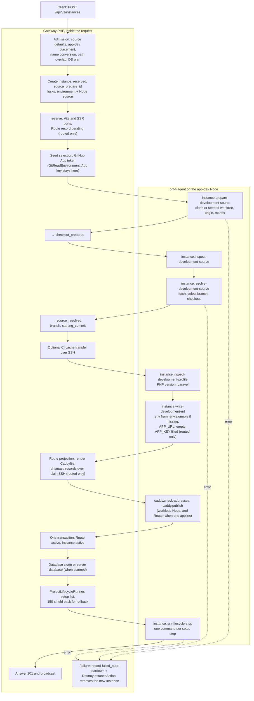
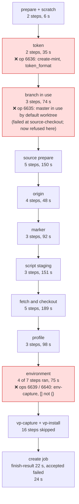

# Instance create: legacy and Swamp flows

The legacy Gateway created a development Instance inside one API request with about seven agent calls. The Swamp port runs the same work as 91 placed steps. In operation 6639 the steps did 4.6 s of remote work and took 957 s. These diagrams show where the steps came from and where the time and the failures went. They are the map for the F9 rebuild: one script step per legacy phase.

Sources:

- Legacy: `CreateInstanceAction` at [`4603475a4c`](https://github.com/hardimpactdev/orbit/tree/4603475a4c), the last commit before [#1616](https://github.com/hardimpactdev/orbit/pull/1616) (`3c897e768a`) replaced it with Swamp admission.
- Swamp: [`workflow-operation-instance-create.yaml`](https://github.com/hardimpactdev/orbit/blob/main/swamp/workflows/workflow-operation-instance-create.yaml) on main at `137da60f1e`, last changed by #2266.
- Times: lane 11's native step history of run `38b1ca91` (operation 6639).

## Legacy flow

`POST /api/v1/instances` called `CreateInstanceAction` inside the request and answered `201` with the active Instance. The Gateway held two locks: the Instance environment lock and the Node's app-dev source lock. It drove a small state machine (`reserved` → `checkout_prepared` → `source_resolved` → `active`). Each Node action was one orbit-agent command, started over SSH through `AgentStep::run`. A retry resumed from the stored state.

| Phase | Legacy action | Actor | File at `4603475a4c` |
| --- | --- | --- | --- |
| Prepare | Validate, reserve the Instance, ports, Route record | Gateway | `apps/gateway/app/Actions/Instances/CreateInstanceAction.php`, `Infrastructure/Instances/NativeDevelopmentInstanceProvisioner.php` (`reserve`) |
| Source | Mint the read token, prepare, inspect and resolve the source | Gateway mints; agent runs git | `Infrastructure/Instances/RemoteDevelopmentInstanceSourceLifecycle.php` (`prepare`, `inspectPrepared`, `resolve`), `apps/agent/src/commands/dev_source.rs` |
| Environment | Profile, then `.env` from `.env.example` with `APP_URL` and a filled `APP_KEY`; database keys came later through environment sync | agent | `Infrastructure/Instances/RemoteDevelopmentInstanceConfigurator.php`, `apps/agent/src/commands/laravel.rs` |
| Setup | Database first, then each setup command | Gateway + agent | `CreateInstanceAction::prepareDatabase`, `finishSetup` (`ProjectLifecycleRunner`) |
| Route | Render Caddy, publish through the agent, republish dnsmasq over SSH | Gateway + agent | `Infrastructure/Instances/NativeDevelopmentRouteProjector.php`, `Infrastructure/Caddy/Build/NodeCaddyBuilder.php`, `Infrastructure/AppDev/DnsmasqPrivateDnsManager.php` |
| Finish | Activate in one transaction; remove a failed new Instance | Gateway | `completeOwned` / `completeWithoutRoute`, `CreateInstanceAction::cleanupFailedCreate` |

Gateway paths are under `apps/gateway/app/`. "Native" in the legacy class names means PHP that drives the agent, not Swamp. An unrouted Instance skipped the Route projection and the `.env` write. The Route and activation came before the database and setup.

One create made about seven agent calls on the app-dev Node: prepare, inspect two or three times, resolve, profile, URL and two Caddy calls. Each setup step added one call. A Router added two calls, and dnsmasq took one plain SSH call. Each agent call was one SSH session. No measured duration is recorded; the request deadline bounded it.

Legacy tests for the parity port, all at `4603475a4c` under `apps/gateway/tests/Feature/`: `Api/InstancesTest.php` (76 tests, deleted in #1616), `Api/InstanceDatabaseCloneTest.php`, `Api/DevelopmentNodeExclusionTest.php`, `Api/InstanceEnvironmentTest.php`, `Domain/ProvisionDevelopmentInstanceTest.php`, `Infrastructure/Instances/NativeDevelopmentRouteProjectorTest.php`. Agent side: the tests in `apps/agent/src/commands/dev_source.rs` and `laravel.rs`.

Later stages were already Swamp: #1616 (`3c897e768a`) admitted an Operation that ran the same agent commands through Kit; #1894 removed Kit; #1929 (`a0d725c290`) made one native root; #2246 (`6ce2d29267`) moved it to SSH from Node 209; #2252 deleted the leftover classes.

## Swamp flow on main

The Gateway validates the request, reserves the Instance and records the intent in one transaction. It refuses a Route, a database and `gh_cli` source access before reservation, so the Swamp flow has no Route or database step. A Swamp run then executes one root on Node 209. Every step has `target: orbit-node-209`. Steps marked SSH run an official `@swamp/ssh` method from 209 against the app-dev Node as its managed user. The other steps run locally on 209: asserts, TypeScript behaviors that shape inputs and render scripts, and `command/shell`.

```mermaid
flowchart TD
  subgraph GW1["Gateway: admission (PHP, one transaction)"]
    A1["StartDevelopmentInstanceCreateAction<br/>validate placement, refuse Route / DB / gh_cli"]
    A2["create Instance: reserved<br/>select seed, record intent"]
    A3["NativeDevelopmentInstanceInput<br/>vault copies: environment, setup_0..n, git_read"]
    A1 --> A2 --> A3
  end

  subgraph PREP["job prepare: 37 steps"]
    P0["prepare-admitted assert<br/>create-local-directory<br/>2 steps, 209"]
    T["token: create-mint-assets, create-mint<br/>2 steps, 209 POSTs to Gateway mint"]
    BR["branch in use: worktrees, available, accepted<br/>3 steps: 1 SSH, 2 on 209"]
    SP["source prepare: assets, read, prepared, init, worktree<br/>5 steps: 3 SSH"]
    OR["origin: assets, read, proof, configure<br/>4 steps: 2 SSH"]
    MK["marker: git-directory, assets, read<br/>3 steps: 2 SSH"]
    SC["script staging: paths, directory, copy<br/>3 steps: 2 SSH"]
    FC["fetch and checkout: fetch, refs, selected, checkout, commit<br/>5 steps: 4 SSH"]
    PR["profile: assets, read, source-result<br/>3 steps: 1 SSH"]
    EN["environment: template asset, template, copy, capture,<br/>write assets, scripts copy, write<br/>7 steps: 4 SSH"]
    P0 --> T --> BR --> SP --> OR --> MK --> SC --> FC --> PR --> EN
  end

  subgraph VP["jobs vp-capture + vp-install: 16 steps"]
    V1["vp-capture: project.json read and copy, requirements<br/>6 steps: 2 SSH"]
    V2["vp-install: manager, cli, install, inventory, verify, result<br/>10 steps: 4 SSH, sudo for manager"]
    V1 --> V2
  end

  subgraph FIN["job create: 38 steps"]
    F0["create-admitted, finish-prepared asserts<br/>setup assets, setup copy"]
    F1["finish-setup-0 .. finish-setup-31<br/>32 SSH steps, one per setup command,<br/>skipped when the list is shorter"]
    F2["finish-result, accepted assert"]
    F0 --> F1 --> F2
  end

  subgraph GW2["Gateway: terminal projection (PHP)"]
    G1["DevelopmentInstanceCreateProjection<br/>reads environment result from vault"]
    G2["Instance: source_resolved, then active<br/>or failed_step + error_code"]
    G1 --> G2
  end

  A3 -- "StartSwampRun: intent inputs + vault key names" --> P0
  T -. "POST /direct-operations/{id}/github-token" .-> GW1
  EN --> V1
  V2 -- "job create: always" --> F0
  PREP -- "job create: always" --> F0
  F2 -- "terminal event + step outputs" --> G1
```

Guards and skips:

- `prepare-admitted`, `vp-capture-admitted`, `vp-install-admitted` and `create-admitted` are asserts guarded by `intent.already_active`. On a repeat create of an active Instance they skip and the jobs do nothing.
- From `source-worktrees` on, each source step has the guard `steps.exists(key, steps[key].status == "failed")`: after the first failure every later source step skips. Steps that read outputs depend on `succeeded or skipped`.

Source steps skip by input:

- `source-worktrees` runs only for a create with a seed repository and commit.
- `source-init` and `source-worktree` choose between a fresh checkout and a seeded worktree.
- `source-origin-configure` runs only when the origin is missing.
- `source-fetch` skips without network, and `source-checkout` skips for a retained source.

Jobs and setup slots:

- `vp-capture` and `vp-install` depend on `prepare` succeeding. A failure there skips all 16 steps.
- Job `create` runs `always`. `finish-prepared` asserts that `vp-result` succeeded, so a failed prepare still reaches `finish-result`, which writes the public failure result.
- Each `finish-setup-N` is a `forEach` over the setup commands with `index == N`. The workflow declares 32 slots; unused slots skip.

Where the Gateway hands over:

| Hand-over | Where | What |
| --- | --- | --- |
| Intent | `StartSwampRun` inputs | Full non-secret intent: source, resolve, SSH target and host pins, setup command digests, VP setup |
| Vault names | `execution_secrets`, vault `orbit-control-inputs` | `environment` (stored values), `setup_0..n` (command text), `git_read` reference |
| Token | `create-mint` POSTs `/api/v1/direct-operations/{id}/github-token` | The Gateway mints the GitHub App token and writes it to the vault; the step sees descriptor names only |
| Environment result | vault key `instance-create-environment-result-{id}` | Rendered values; the public result carries keys only |
| Terminal projection | terminal event + `finish-result` outputs | The Gateway sets `source_resolved`, stores the environment, then `active`, or records `failed_step` and `error_code` |

## Mapping

Legacy phase to Swamp steps. "Steps" counts declared steps in the workflow on main.

| Phase | Legacy action | Actor | Swamp steps | Steps | Fan-out |
| --- | --- | --- | --- | --- | --- |
| Prepare | Admission, reserve, ports, Route record | Gateway PHP | Gateway admission + `prepare-admitted`, `create-local-directory` | 2 | ports and Route record dropped |
| Source | GitHub token for the repository | Gateway PHP, passed to the agent | `create-mint-assets`, `create-mint` | 2 | 1 → 2 |
| Source | `instance.prepare-development-source`: branch check, clone or seeded worktree, origin, ownership marker | agent, 1 command | `source-worktrees` … `source-marker-read`, `source-paths`, `source-scripts-*` | 18 | **1 → 18** |
| Source | `instance.resolve-development-source`: fetch, select branch, checkout | agent, 1 command | `source-fetch`, `source-refs`, `source-selected`, `source-checkout`, `source-commit` | 5 | 1 → 5 |
| Source | `instance.inspect-development-source` and `instance.inspect-development-profile` | agent, 2 commands | `source-profile-assets`, `source-profile-read`, `source-result` | 3 | |
| Environment | `instance.write-development-url`: `.env` from `.env.example`, `APP_URL`, `APP_KEY` (routed only) | agent, 1 command | `env-template-asset` … `env-write` | 7 | **1 → 7** |
| Runtime | none in create | | `vp-capture` + `vp-install` (Vite+ runtime) | 16 | **new** |
| Setup | Database clone or server database, then `ProjectLifecycleRunner`: one agent `instance.run-lifecycle-step` per command | Gateway + agent, n commands | `finish-prepared`, `finish-setup-assets`, `finish-setup-copy`, `finish-setup-0..31` | 35 | n → n + 3 (32 declared) |
| Route | Caddy through `caddy.check-addresses` and `caddy.publish`; dnsmasq over SSH | Gateway + agent | none: native create refuses a Route | 0 | **dropped** |
| Finish | Activate in one transaction; rollback removes a failed new Instance | Gateway PHP | `create-admitted`, `finish-result`, `accepted` + terminal projection | 3 | no rollback |

Totals: legacy about seven agent calls plus one per setup command, inside one Gateway request. Swamp declares 91 steps: 58 SSH, 25 local on 209 and 8 asserts.

## Failures and time

Operation 6639 ran on Instance 780 (`firewall-allowlist`, Project 46, beast). The run took 957.4 s and failed at `env-capture`. The 15 SSH steps that lane 11 matched to their method spent 4.6 s in the method and 539.9 s as steps. Across 31 matched steps, 453 s passed before a worker took the step, 160 s inside the worker and 309 s after it.

| Operation | Failed step | Error code | Cause | Fix |
| --- | --- | --- | --- | --- |
| 6635 | `source-checkout` | `instance.create_source_failed` | `master` was checked out by the `default` worktree; git exited 128 | #2266 adds `source-worktrees`, `source-branch-available`, `source-branch-accepted` and refuses `instance.branch_in_use` before any write |
| 6636 | `create-mint` | `instance.create_source_failed` | The Gateway refused GitHub's stateless token (`ghs_…` with JWT dots) as `token_format`; no stderr reached history | #2266 accepts the documented format |
| 6617, 6618, 6630 to 6632 | before the run | `swamp.vault_sync_unavailable`, `swamp.start_refused` | The vault copy or the run start failed before any step ran | Outside this workflow; not traced here |
| 6639, 6640 | `env-capture` | `instance.create_environment_failed` | An Instance with no stored values sent `"values": []`; capture expects an object | #2273 sends `{}` |

Step times of operation 6639 by group:

| Group | Steps run | Wall time | Method time |
| --- | --- | --- | --- |
| prepare + scratch | 2 | 6.4 s | 0.0 s |
| token | 2 | 35.4 s | 3.7 s (`create-mint`, local) |
| branch in use | 3 | 73.8 s | 0.6 s |
| source prepare | 4 (1 skipped) | 149.6 s | 0.1 s |
| origin | 3 (1 skipped) | 48.4 s | 0.0 s |
| marker | 3 | 92.0 s | 0.1 s |
| script staging | 3 | 150.5 s | 0.6 s |
| fetch and checkout | 5 | 188.8 s | 2.6 s |
| profile | 3 | 97.5 s | 0.1 s |
| environment | 4 (3 skipped) | 75.2 s | 0.6 s |
| vp-capture, vp-install | 0 (16 skipped) | 1.0 s | none |
| create | 4 (13 skipped) | 23.8 s | none |
| **Total** | **36 run, 34 skipped** | **957.4 s** | **8.3 s** |

Group times leave out about 15 s of gaps between groups. Method time is the official method's own time; `create-mint` and `create-local-directory` count their local command. Each step paid about 20 to 60 s of queue and worker overhead for well under a second of work. The cost follows the step count, not the work. The F9 rebuild with one script step per phase removes most of it: six phase steps at today's overhead would take about 2 to 3 minutes, and a free worker brings it near the 10 s target.
