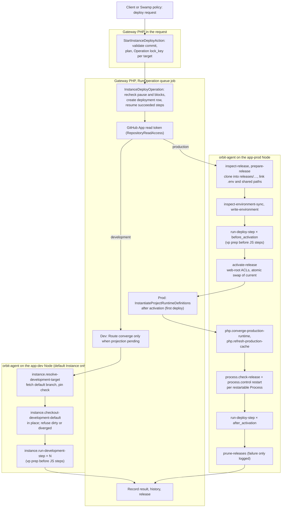
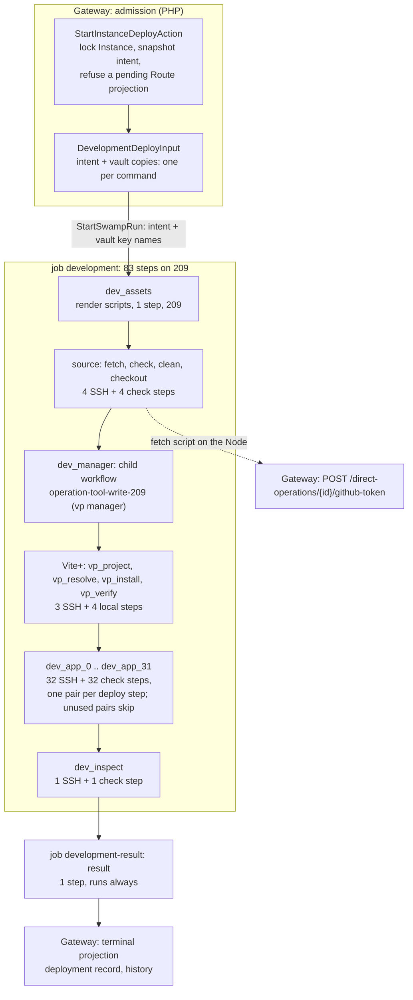
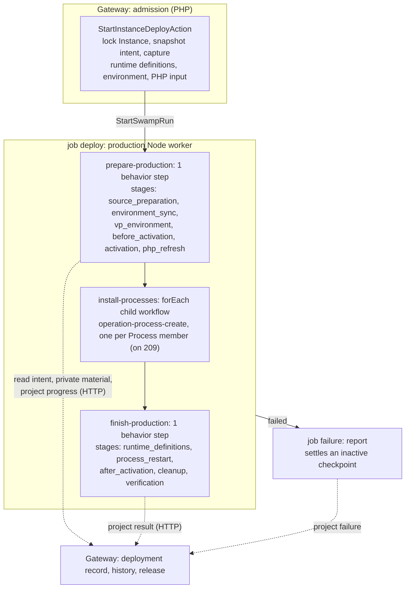
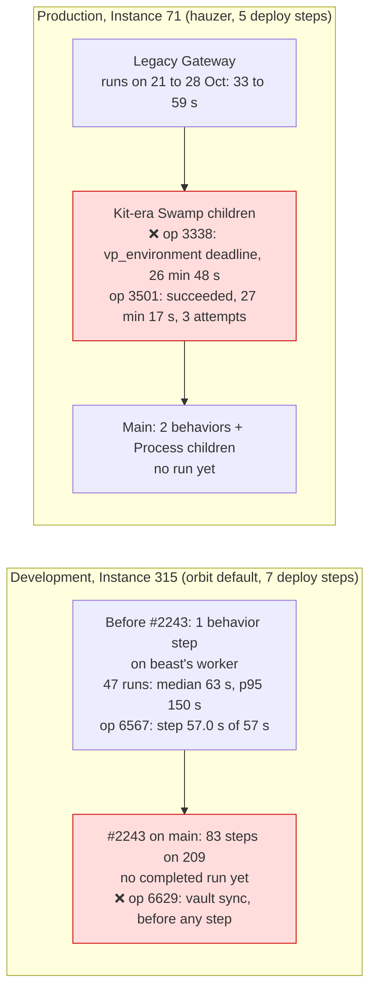

# Instance deploy: legacy and Swamp flows

The legacy Gateway deployed from one queued job: a dev deploy made 2 agent calls plus one per deploy step, and a production deploy about 8 plus one per step and two per restarted Process. Production deploys of hauzer took 33 to 59 s. The Swamp ports split the same work into children or steps. The Kit-era production run took 27 min, and development on main now declares 83 steps. This page is the map for the F9 rebuild of `instance.deploy`.

Sources:

- Legacy: [`d65c5995de`](https://github.com/hardimpactdev/orbit/tree/d65c5995de), the last commit before `7be1afa8e7` (#1590, 29 October) moved dev and prod deploy and rollback to Swamp. Swamp side: orbit-swamp#77.
- Swamp: [`workflow-operation-instance-deploy-direct.yaml`](https://github.com/hardimpactdev/orbit/blob/main/swamp/workflows/workflow-operation-instance-deploy-direct.yaml) on main at `d29eabbf83`. Development changed last in #2243; production in #433 and #1964.
- Runs: Gateway Operation records, deployment records and beast's worker journal.

## Legacy flow

`POST /api/v1/instances/{id}/deploy` admitted an `instance.deploy` Operation inside the request and answered `202`. A `RunOperation` job on the `operations` queue then ran `InstanceDeployOperation` (one try, 1,700 s timeout). Each Node action was one orbit-agent command over SSH. Deploy-step output streamed live on Reverb channel `private-operation.{id}`. The job kept an 8 KiB tail per step and saved row events after each step.

| Phase | Legacy action | Actor | File at `d65c5995de` |
| --- | --- | --- | --- |
| Admission | Validate, plan, lock the target, queue the job | Gateway, request | `apps/gateway/app/Actions/Instances/StartInstanceDeployAction.php` |
| Run | Pause and block recheck, deployment row, resumable steps | Gateway, queue | `Domain/Instances/Deployment/InstanceDeployOperation.php`, `OperationDeploymentSteps.php` |
| Source (dev) | Fetch, pin check, checkout in place | agent, 2 calls | `Actions/Instances/DeployDefaultInstanceAction.php`, `RemoteDevelopmentDeployment.php`; agent `dev_deploy.rs` |
| Source (prod) | Inspect and prepare a new release | agent, 2 calls | `Actions/Instances/DeployInstanceAction.php`, `RemoteProductionDeployment.php`; agent `production.rs` |
| Environment (prod) | Inspect and write `.env` | agent, 2 calls | `SynchronizeInstanceEnvironmentAction.php`, `RemoteInstanceEnvironmentAccess.php` |
| Steps | One agent call per step; Vite+ prep before JS steps | agent, N calls | `deploy_step.rs`, `dev_deploy.rs`, `PrepareVpEnvironmentAction.php` |
| Activation (prod) | Atomic swap of `current`; install captured runtime definitions | agent + Gateway | `production.rs`, `DeployInstanceAction.php` |
| PHP (prod) | Converge the FPM runtime, refresh the cache | agent, 2 calls | `RemoteProductionPhpRuntimeManager.php` |
| Processes (prod) | Check the release, restart | agent, 2 per Process | `RestartInstanceProcessesAction.php`, `RemoteProcessRuntimeManager.php` |
| Cleanup (prod) | Prune releases, keep 3 in total, selected and previous first | agent, 1 call | `DeploymentRelease.php` |

Gateway paths are under `apps/gateway/app/`; agent paths are under `apps/agent/src/commands/`. The production deadline was the step timeouts plus 900 s, capped at 1,600 s. A failed deploy recorded its boundary and did not roll back. Rollback was a separate Operation: inspect, activate, PHP refresh and Process restart.

Legacy tests for the parity port, at `d65c5995de` under `apps/gateway/tests/Feature/`: `Domain/DeployInstanceTest.php` (27), `Api/PinnedInstanceDeployTest.php` (22), `Api/InstanceRollbackOperationTest.php` (17), `Domain/DeployDevelopmentDefaultsTest.php` (14), `Infrastructure/Instances/ProductionReleaseCommandsTest.php` (12), `Api/InstanceDeployStepsTest.php` (11), `Api/ProjectDevelopmentDeployStepsTest.php` (10), `Domain/DevelopmentDeploymentTest.php` (9) and eight smaller files. Agent side: `dev_deploy_tests.rs` (15), `production_tests.rs` (16), `production_home_tests.rs` (14) and `deploy_step.rs` (5).

Later stages: #1590 ran the same actions as Kit children; #1867 made development one native behavior step on the Node's worker; #1894 removed Kit; #433 and #1964 gave production its two-behavior shape; #2243 moved development to SSH from Node 209.

## Swamp flow on main

One workflow, `operation-instance-deploy-direct`, holds both variants. Each step guards on `intent.deployment.variant`, or, for `install-processes`, gets an empty `forEach` list, so a run executes one variant and skips the other.

| Job | Placement | Steps | Runs for |
| --- | --- | --- | --- |
| `development` | Node 209; 40 steps reach the app-dev Node over `@swamp/ssh` | 83 | development |
| `development-result` | Node 209 | 1 | development |
| `deploy` | the production Node's own worker (`orbit-node-<node_id>`); `install-processes` runs on 209 | 3 (one is a `forEach` child workflow) | production |
| `failure` | the production Node's own worker | 1 | production, after a failed `deploy` |

### Development

The Gateway validates the request, captures public intent and names vault copies for each command, then starts the run. The run never calls the Gateway except for the GitHub token: for a private repository, the `fetch` script on the Node POSTs to the token endpoint.

Guards and skips:

- Every development step skips for a production run.
- `dev_manager` and the four Vite+ steps skip when `intent.deployment.needs_vp` is false.
- `dev_app_N` runs only for a Project with more than N deploy steps.
- `dev_app_N` also needs checkout, Vite+ and every earlier app step to succeed.
- `dev_inspect` runs only when every earlier action succeeded.
- `dev_clean` and `dev_checkout` run under `flock --nonblock` on the checkout; a held lock exits 73. App steps take no lock.
- Source and Vite+ SSH steps time out after 600 s; an app step after its command timeout plus 10 s. Each `*_check` step is a local behavior that decodes the SSH output.

### Production

The `deploy` job runs on the production Node's own worker, not on 209. Two TypeScript behaviors do the work. Each runs several stages locally and keeps a checkpoint resource. Both read intent and private material from the Gateway and project progress back over HTTP.

Each stage checks for cancellation before it starts and saves its checkpoint after it ends. The checkpoint lets a restarted run continue without repeating an effect. `activation` swaps `current` to the new release. `cleanup` prunes old releases.

## Mapping

Legacy call to Swamp steps on main. Development counts declared steps in jobs `development` and `development-result` (84); production counts steps in job `deploy`.

| Phase | Legacy calls | Swamp on main | Steps | Fan-out |
| --- | --- | --- | --- | --- |
| Dev: admission and token | Gateway + token in the job | Gateway admission; `dev_assets`; token POST from the `fetch` script | 1 | |
| Dev: source | 2 agent calls | `dev_fetch`, `dev_check`, `dev_clean`, `dev_checkout`, each with a `*_check` step | 8 | **2 → 8** |
| Dev: Vite+ | 1 to 4 calls per JS step | `dev_manager` child + `vp_project`, `vp_resolve`, `vp_install`, `vp_verify` with checks | 8 | once per deploy |
| Dev: deploy steps | N agent calls | `dev_app_0..31`, each with a check step | 64 declared, 2N run | **N → 2N** |
| Dev: finish | Gateway | `dev_inspect` + check, job `development-result` | 3 | new inspection |
| Prod: source, environment, Vite+, before steps, activation, PHP | about 7 + N_before calls | `prepare-production`: one behavior step | 1 | **many → 1** |
| Prod: Process definitions | Gateway, after activation | `install-processes`: one `operation-process-create` child per member, on 209 | P | **1 → P children** |
| Prod: Schedule definitions, restart, after steps, cleanup, verification | 2P + N_after + 1 calls | `finish-production`: one behavior step | 1 | **many → 1** |
| Prod: failure | job records the boundary | job `failure`: `report` | 1 | |

The two variants moved in opposite directions. Development went from 2 + N agent calls to 12 + 2N run steps (20 + 2N with Vite+), counting the result step, each paying placement, SSH and history overhead. Production went from separate agent calls to two large TypeScript behaviors on the Node's worker. Those behaviors call the Gateway over HTTP for intent, private material and progress, which the porting guide marks as an anti-pattern.

## Times and failures

No deploy has run on either current shape yet. The development port (#2243) went live at 07:37Z on 1 November. Its first admission, operation 6629, failed before any step ran with `swamp.vault_sync_unavailable`. No production deploy has run since #433 and #1964 replaced the Kit-era children with two behaviors. The numbers below come from the shapes just before each port, and from the legacy Gateway.

| Run | Shape | Result | Time |
| --- | --- | --- | --- |
| 47 development runs on Instance 315, 31 Oct 20:55Z to 1 Nov 05:39Z | One `@nckrtl/instance-deploy-direct.run` step on beast's worker | succeeded | median 63 s, p95 150 s, max 230 s |
| 6567 | same | succeeded | 57 s; the worker journal shows the single step took 57.0 s |
| 6291 | same | `deployment.interrupted` at `native_execution` | 51 s |
| 6569 | same | `operation.native_failed`, interrupted | 2 min 48 s |
| 6629 | #2243, 209 SSH | `swamp.vault_sync_unavailable`, before any step | 2 s |
| Production on Instance 71, 21 to 28 Oct | legacy Gateway queue job | succeeded | 33 to 59 s each |
| 3338 | Kit-era Swamp children | `deployment.deadline_exceeded` at `vp_environment` | 26 min 48 s |
| 3501 | same | succeeded after 3 attempts | 27 min 17 s |

The 30 October incident log names the causes of the production stalls:

- A Vite+ child stalled while Services ran out of inodes (`ENOSPC`).
- `install_instance_definitions` behavior names were 66 to 67 characters, over Swamp's 64-character limit (fixed in orbit-swamp#144).
- Every five minutes, `fleet.peer_dns` took Node locks, so deploy children returned `operation.target_busy`.
- PHP runtime children stalled during the nckrtl cutover.

Each split of one legacy call into children or steps added a queue wait and a failure point. The single-step development shape ran in about a minute. The 83-step shape will pay the per-step overhead measured for `instance.create` (20 to 60 s each) unless the F9 rebuild folds it into one step per phase.

