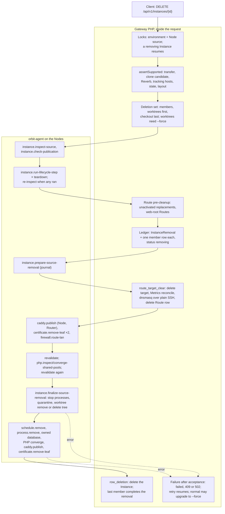
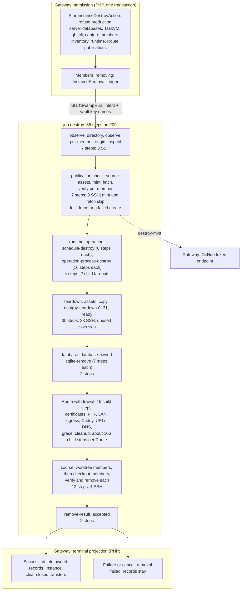
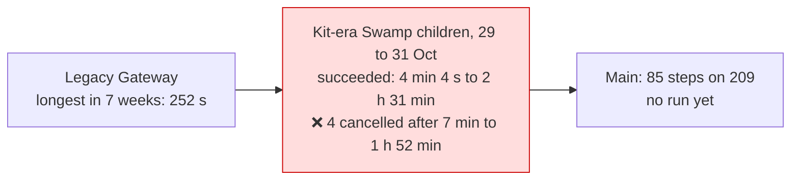

# Instance destroy: legacy and Swamp flows

The legacy Gateway removed a development Instance inside one API request. A typical removal made about 26 agent calls, plus 2 DNS calls over SSH, and the longest recorded run took 252 s. The Swamp port declares 85 steps on Node 209, and 18 of them start child workflows. A routed Instance can expand Route withdrawal alone to about 106 child steps. Kit-era Swamp removals took 4 min to 2 h 31 min. This page is the map for the F9 rebuild of `instance.destroy`.

Sources:

- Legacy: `DestroyInstanceAction` at [`4603475a4c`](https://github.com/hardimpactdev/orbit/tree/4603475a4c). Development removal moved to Swamp admission in `3c897e768a` (#1616, 29 October). Production removal followed in `6b71cd0168` (#1598).
- Swamp: [`workflow-operation-instance-destroy.yaml`](https://github.com/hardimpactdev/orbit/blob/main/swamp/workflows/workflow-operation-instance-destroy.yaml) on main at `9c2a850f0a`, last changed by #2246.
- Runs: Gateway Operation records and ADR 0218.

## Legacy flow

`DELETE /api/v1/instances/{id}` called `DestroyInstanceAction` inside the request, under a 570 s command deadline. Each Node action was one orbit-agent command over SSH through `AgentStep::run`. Private DNS was a plain SSH script on the VPN owner. An `InstanceRemoval` ledger recorded each member and step, so a retry resumed at the first unfinished step.

The ledger ran five steps per member, one member after another: `source_preparation`, `route_target_clear`, `source_finalization`, `runtime_cleanup` and `row_deletion`.

| Phase | Legacy action | Actor | File at `4603475a4c` |
| --- | --- | --- | --- |
| Admission | Locks, support checks, deletion set, source inspection | Gateway + agent | `apps/gateway/app/Actions/Instances/DestroyInstanceAction.php` (`assertSupported`, `deletionSet`) |
| Teardown | One agent call per teardown step, then re-inspect | agent | `DestroyInstanceAction::acceptLocked`, `Domain/Projects/ProjectLifecycleRunner.php` |
| Ledger | `InstanceRemoval` and member rows under `ProcessAdmissionLock` | Gateway | `DestroyInstanceAction.php` (lines 341 to 453) |
| Route | Clear the target; Caddy, certificates, LAN firewall, Metrics, DNS | Gateway + agent + SSH | `Infrastructure/Instances/NativeInstanceRemovalProjector.php`, `Infrastructure/AppDev/DnsmasqPrivateDnsManager.php` |
| Source | Revalidate, withdraw the PHP pool, finalize removal | agent | `Infrastructure/Instances/RemoteDevelopmentInstanceSourceRemoval.php`; agent `instances.rs`, `source.rs` |
| Runtime | Schedules, Processes, owned databases, PHP, Caddy, certificates, Metrics | agent | `DestroyInstanceAction::advance` (`runtime_cleanup`), `DropOwnedDatabasesAction` |
| Record | Delete the Instance; complete the removal | Gateway | `DestroyInstanceAction::advance` (`row_deletion`) |

Gateway paths are under `apps/gateway/app/`; agent paths are under `apps/agent/src/commands/`. Production removal ran no teardown and read its inventory from records. It cleared the current release and removed the PHP runtime and the production home. A forced removal skipped content and publication checks and cascaded through registered worktrees. It revalidated every member at each finalize, so its inspection calls grew with the square of the member count.

A typical normal removal had one checkout and a private Route behind a separate Router, with no teardown, Processes or databases. It made about 26 agent calls, 2 DNS calls over SSH and two Metrics reconciles. Each teardown step added one call, plus two for re-inspection. Each Process, Schedule or owned database added one call. ADR 0218 measured Activity from 26 August to 16 October: the longest `instance:destroy` took 252 s.

Legacy tests for the parity port, at `4603475a4c` under `apps/gateway/tests/Feature/`:

| File | Tests |
| --- | --- |
| `Domain/InstanceRemovalCoordinatorTest.php` | 43 |
| `Infrastructure/Instances/DevelopmentSourceRemovalCommandTest.php` | 38 |
| `Infrastructure/Instances/NativeInstanceRemovalProjectorTest.php` | 16 |
| `Domain/DestroyInstanceActionTest.php` | 7 |
| `Database/InstanceRemovalMigrationTest.php` | 5 |
| `Infrastructure/Instances/InstanceRemovalInspectionTest.php` | 4 |
| `Api/InstancesTest.php` | about 25 of its 96 tests |

Agent side: `instances_tests.rs` (25), `instances_safety_tests.rs` (14) and `instances_recovery_tests.rs` (10).

Later stages: #1616 and #1598 ran removal as Kit child Operations; #1947 deleted `DestroyInstanceAction`; #2196 deleted the removal projector; #2246 moved development removal to SSH from Node 209; #2252 deleted the leftover source-removal classes.

## Swamp flow on main

The Gateway checks the request, captures the member set, source identity, worktree inventory, owned resources and the full Route publications, and marks the members `removing`, all in one transaction. It refuses production Instances, managed server databases, TaskVM workspaces and, without `--force`, `gh_cli` source access before admission with `operation.kind_unavailable`. The run has one job on Node 209. Steps marked SSH reach the app-dev Node over `@swamp/ssh`. Child workflows run their own steps on 209 or on the target.

Guards and skips:

- Per-member steps are `forEach` over `intent.members`. Worktree members are removed before checkout members.
- `destroy-origin` runs only when the member's observation asks for an origin read.
- `destroy-mint` and `destroy-fetch` skip for `--force` and for a failed create.
- `destroy-fetch` also skips for a member that needs no origin read.
- `destroy-teardown-N` is a `forEach` over the teardown command with index N. The workflow declares 32 slots.
- Every `withdraw_*` child skips after the first failed `withdraw_*` step.
- An unrouted Instance has empty publication lists, so all 15 children skip.
- Each `*-ready` step is a local behavior that requires the earlier fan-out to have succeeded.

## Mapping

Legacy action to Swamp steps on main. "Steps" counts declared steps in the parent; child steps are per item.

| Phase | Legacy calls | Swamp on main | Steps | Fan-out |
| --- | --- | --- | --- | --- |
| Admission | Gateway, in the request | Gateway, one transaction; production refused | 0 | production **dropped** |
| Source inspection | 2 agent calls | `destroy-directory`, `observe-asset`, `observe`, `observed`, `origin-assets`, `origin`, `inspect` | 7 | **2 → 7** |
| Publication check | `check-publication`, 1 call | `source-assets`, `mint`, `fetch-files`, `fetch`, `verify-asset`, `verify`, `verified` | 7 | **1 → 7**, plus a token mint |
| Runtime | 1 call per Process and Schedule | `destroy-schedules` (6 child steps each), `destroy-processes` (16 child steps each), 2 ready steps | 4 | **1 → 6 or 16** per item |
| Teardown | 1 call per step + 2 re-inspections | `step-assets`, `step-copy`, `teardown-0..31`, `teardown-ready` | 35 | n → n + 3 |
| Database | 1 call per owned database | `destroy-sqlite` (7 child steps each), ready | 2 | **1 → 7** per database; server databases refused |
| Route | about 10 calls + 2 DNS SSH + Metrics | 15 `withdraw_*` children + `withdraw` | 16 | **about 12 → about 106** per Route |
| Source removal | prepare, revalidate twice, PHP pool, finalize: about 10 calls, plus receipt reads on recovery | worktree and checkout verify and remove, 4 check steps | 12 | **about 10 → 12**, PHP pool moves to Route children |
| Finish | Gateway, row deletion | `remove-result`, `accepted`, then the terminal projection | 2 | |

Totals: legacy about 26 agent calls for a typical routed removal, inside one request. Swamp declares 85 parent steps: 43 SSH, 23 local, 18 child workflows and 1 assert. A routed Instance with one Process adds about 120 child steps.

## Times and failures

No removal has run on the 209 shape since #2246. Every recent run used the Kit-era children, with members, Route and source as separate child Operations.

| Operation | Instance | Route | Result | Time | Attempts |
| --- | --- | --- | --- | --- | --- |
| 5784 | 776 | none | succeeded | 5 min 13 s | 1 |
| 5654 | 775 | none | cancelled at `removal-revalidate` | 7 min 31 s | 3 |
| 5602 | 775 | none | cancelled | 39 min 6 s | 5 |
| 5524 | 775 | none | cancelled | 1 h 2 min 47 s | 5 |
| 5237 | 774 | none | succeeded | 6 min 20 s | 1 |
| 4709 | 773 | none | succeeded | 4 min 4 s | 1 |
| 3877 | 767 | 392 | succeeded | 2 h 30 min 41 s | 4 |
| 3741 | 766 | 391 | succeeded | 23 min 11 s | 1 |
| 3329 | 765 | 387 | succeeded | 38 min 12 s | 1 |
| 2752 | 765 | 387 | cancelled at `removal-accept`, a failed-create cleanup | 1 h 51 min 53 s | 47 |

Unrouted removals took 4 to 6 min when they succeeded. Routed removals took 23 min to 2 h 31 min, because Route withdrawal fanned out into the most children. Repeated attempts stretched the cancelled runs: operation 2752 made 47 attempts before it was cancelled. The 209 shape folds the children into one run but keeps the fan-out: 85 parent steps plus about 106 child steps per Route. At the 20 to 60 s per step measured for `instance.create`, a routed removal would still take hours. The F9 rebuild needs one script step per phase: inspect, check, runtime, teardown, database, Route, source and finish.
