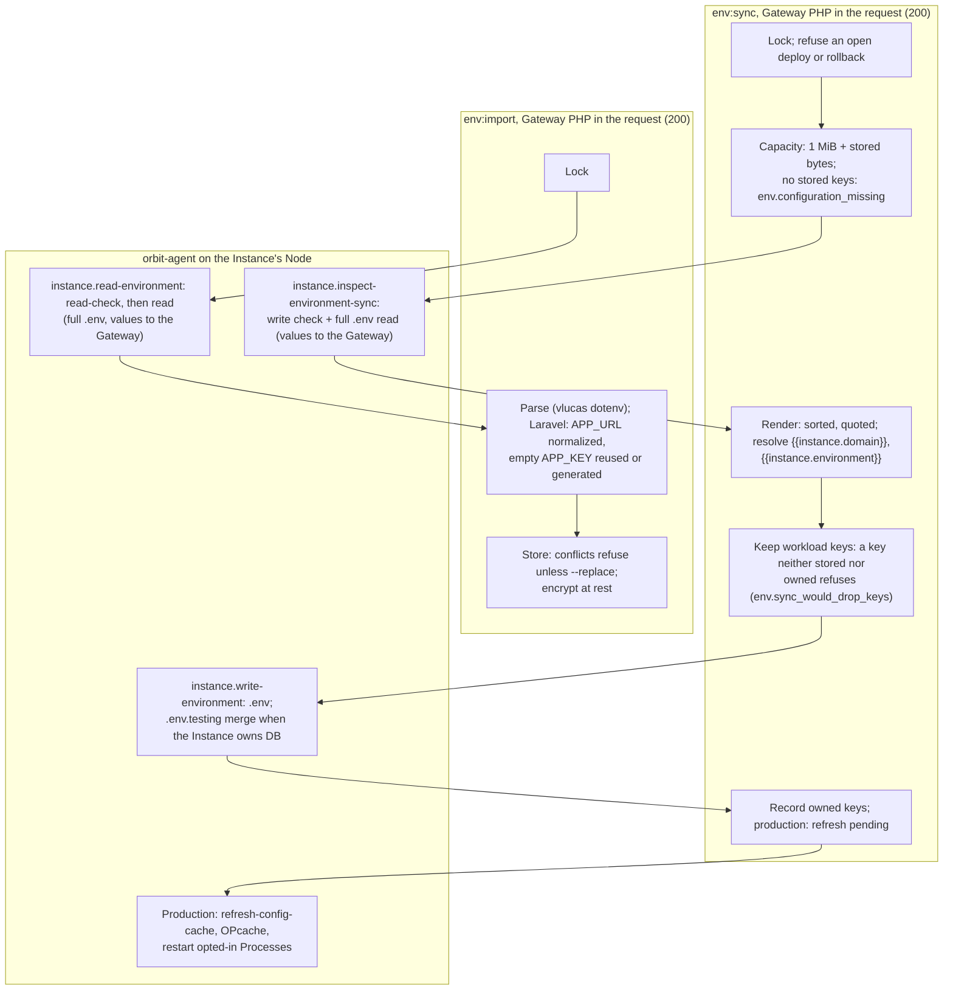

# Instance environment sync and import: legacy and Swamp flows

`orbit env:sync` writes an Instance's stored environment to its workload `.env`. `orbit env:import` does the reverse: it reads the workload `.env` and stores its values in the Gateway. Legacy did both inside the API request with orbit-agent commands, and both read the whole `.env`, values included, into the Gateway. On main, sync is a Swamp run: the Node reads the file locally and only key names come back. Import is not ported. It still reads the whole file into the Gateway through the agent command `instance.read-environment`. This page is the map for the F9 rebuild of both.

Sources:

- Sync, legacy: `SynchronizeInstanceEnvironmentAction` at [`76afc52be7`](https://github.com/hardimpactdev/orbit/tree/76afc52be7). #1636 (`58368bd6bf`, 29 October) added a Swamp child admission for internal callers. #1911 (`6b3416ae75`, 31 October) switched the API to an Operation.
- Sync, Swamp: [`workflow-operation-instance-environment.yaml`](https://github.com/hardimpactdev/orbit/blob/main/swamp/workflows/workflow-operation-instance-environment.yaml), from orbit-swamp#370, last changed by #2152.
- Import: `ImportInstanceEnvironmentAction` is the same at `76afc52be7` and on main; it never switched.
- Rule, from the Recall decision "Development create renders .env in the Gateway; no Node read-back" (ADR 0234).
- Rule, from the Recall decision "Execution secrets live in Swamp vaults; the Gateway stays their source of truth".
- Rule, from sub-orchestrator B's decision of 1 November 11:25Z. ADR 0234 itself is not on main yet.

## The rule, and how import fits it

The rule has two parts: the Gateway owns every secret, and create reads nothing back.

- **The Gateway owns every secret.** Environment values and credentials live in the Gateway.
- **Execution copies go through the vault.** The Gateway pushes an execution copy of each changed value into the Swamp vault.
- **Steps read the vault.** Steps read values with `vault.get` and never receive secrets as inputs or arguments.
- **Swamp outputs go to a vault too.** Secrets that a step produces go to a vault key, never to public outputs.
- **Create reads nothing back.** Create renders `.env` in the Gateway from `.env.example`, `APP_URL`, a generated `APP_KEY` and the database keys.
- **The Node only writes.** The Node writes that file. Nothing reads `.env` back from the Node during create.

**Legacy import squares with the rule only as an explicit adoption.** Import is the one path by which values that an operator put in a `.env` by hand become Gateway-owned. After an import, the Gateway holds and encrypts those values, and from then on sync writes them out. So the result agrees with "the Gateway owns every secret", and the "no read-back" rule is scoped to create, which import is not.

The way legacy import gets there conflicts with the direction since #1911. The plaintext file, secrets included, travels over SSH into the PHP request, inside an open database transaction. The legacy `importExisting` was a read-back during create, the exact thing the rule forbids; it has had no caller since #1818. `docs/reference/environment-variables.md` still says its `APP_KEY` rule "also applies to the existing-file import during Instance creation"; that sentence is stale. Legacy sync also read the whole file into the Gateway, only to learn its key names; main keeps that read on the Node.

**What a native import may read from the Node:**

- the Instance's own `.env` at the admitted application path, and nothing else;
- the file's metadata: owner, mode, size and whether it is a symlink;
- at most 1 MiB, the legacy bound.

**What a native import may not do:**

- put values in step outputs, standard output, run history, workflow inputs or command arguments;
- read `.env.testing`, other files, or follow a symlink out of the checkout;
- change the file;
- run as part of `instance.create`, register, clone or transfer.

**How the values reach the Gateway:** the step writes the raw file bytes to a vault key named for the Operation. The step's public output carries only the key names, the byte count and a digest. The Gateway projection reads that vault copy once, parses it with the legacy parser and stores the values.

Create already reads a step-written vault copy (`instance-create-environment-result-<id>` in `orbit-control-inputs`), but its step writes values it assembled from Gateway input and `.env.example`, not raw bytes read from the Node, and the copy is never deleted.

Two parts are new for import: raw file bytes in the copy, and deleting the copy after the projection reads it, which needs a delete method that `SwampVaultExecutionCopy` lacks today. Parsing stays in one place, the Gateway.

## Legacy flow

Both commands ran inside the API request with the per-Instance environment lock (`env.operation_busy` after 30 s). Each Node action was one orbit-agent command over SSH.



| Phase | Legacy action | Actor | File at `76afc52be7` |
| --- | --- | --- | --- |
| Sync: lock and capacity | Instance lock, deploy guard, capacity | Gateway | `apps/gateway/app/Actions/Instances/SynchronizeInstanceEnvironmentAction.php`, `InstanceEnvironmentStore.php` |
| Sync: read | Write check and full read of `.env` | agent | `Infrastructure/Instances/RemoteInstanceEnvironmentAccess.php` (`instance.inspect-environment-sync`) |
| Sync: render | Render stored values; refuse dropped workload keys | Gateway | `InstanceEnvironmentRenderer`, `assertKeepsWorkloadKeys` |
| Sync: write | `.env`; `.env.testing` merge | agent | `instance.write-environment` |
| Sync: refresh | Config cache, OPcache, Process restart on production, only when changed or pending | agent | `RefreshInstanceEnvironmentRuntimeAction.php` |
| Import: read | Read check and full read | agent | `instance.read-environment` |
| Import: parse and store | Parse, normalize Laravel keys, store with conflict rules | Gateway | `ImportInstanceEnvironmentAction.php`, `InstanceEnvironmentImporter.php`, `InstanceEnvironmentStore::import` |

Gateway paths are under `apps/gateway/app/`. Legacy tests, at `76afc52be7` under `apps/gateway/tests/Feature/`: `Api/InstanceEnvironmentTest.php` (33), `Domain/EnvironmentSyncMaterialTest.php` (14), `Api/InstanceEnvironmentChildTest.php` (10), `Infrastructure/InstanceEnvironmentOperationLockTest.php` (3), plus files that still exist on main: `RemoteInstanceEnvironmentAccessTest.php` (8), `Domain/InstanceEnvironmentImportTest.php` (6), `Domain/InstanceEnvironmentConcurrencyTest.php` (7) and smaller ones. Agent: `environment_tests.rs` (10).

## Swamp flow on main

**Sync.** `StartInstanceEnvironmentSyncAction` refuses with `env.configuration_missing` when nothing is stored and answers `202` with an Operation. The intent holds the public placement plan and a reference to private material. The run has one job with one TypeScript behavior step on the Instance Node's own worker, not on 209. The step fetches the rendered content from the Gateway's private-material endpoint, then reads, checks and writes locally.

**Import.** `POST /api/v1/instances/{instance}/environment/import` still calls `ImportInstanceEnvironmentAction` in the request. The lock is now only a database transaction. The two agent calls run inside that open transaction, and nothing raises `env.operation_busy` any more.

```mermaid
flowchart TD
  subgraph SYNCM["env:sync on main"]
    G1["StartInstanceEnvironmentSyncAction (202):<br/>placement plan + private-material reference"]
    W1["job environment on the Node's worker:<br/>synchronize (one behavior step)"]
    W2["GET private-material: rendered .env,<br/>keys, owned keys, testing plan"]
    W3["local: inspect .env (read stays on the Node),<br/>key check, write .env, merge .env.testing"]
    W4["runtime refresh: config cache, PHP, Processes<br/>(every production sync)"]
    P1["NativeInstanceEnvironmentProjection:<br/>owned keys; clear refresh pending"]
    G1 --> W1 --> W2 --> W3 --> W4 --> P1
  end

  subgraph IMPM["env:import on main (not ported)"]
    J1["ImportInstanceEnvironmentAction, in a DB transaction"]
    J2["agent instance.read-environment ×2<br/>full .env, values to the Gateway"]
    J3["parse, store"]
    J1 --> J2 --> J3
  end
```



Differences from legacy:

- Sync returns key names, a change flag and the test database name; no value leaves the Node.
- Sync refreshes the production runtime on every run; legacy skipped it when nothing changed (`skipped_unchanged`).
- Sync's capacity is a fixed 2 MiB; legacy used 1 MiB plus the stored bytes.
- An open deploy or rollback now refuses through the generic `operation.target_busy`.
- The API answers `202` with an Operation, and `orbit env:sync` follows it to the end.
- `SynchronizeInstanceEnvironmentAction` survives for two synchronous internal callers, `ConvergeRouteAction` and `NativeProjectUpdateProjectionMutator`, which still read the file through the agent.

## Mapping

Legacy call to Swamp steps on main.

| Phase | Legacy calls | Swamp on main | Steps |
| --- | --- | --- | --- |
| Sync: lock, capacity, render | Gateway | admission + Gateway private material | 0 |
| Sync: read, check, write, testing merge | 2 agent calls | `synchronize` behavior, local actions | 1 step for all |
| Sync: runtime refresh | up to 3 agent calls + 1 per Process | same step | (same) |
| Sync: record | Gateway | projection | 0 |
| Import: read | 2 agent calls (values into the Gateway) | unchanged: 2 agent calls | not ported |
| Import: parse and store | Gateway | unchanged | not ported |

## Times and failures

Thirty `instance.sync_environment` Operations have run, all succeeded, in 2 to 6 s each. The newest, 5755, ran on 31 October, before #2152 changed the shape on 1 November 00:31Z, so none has run on the current shape. Several were operator canaries on Instance 761 that changed nothing. Import leaves no Operation records; it runs inside the request.

## F9 rebuild phases: env:sync

Legacy is the spec (PLAN F9), with the read rule above. Each phase becomes one script file run as one step.

### 1. Admit the sync (Gateway)

Runs on: Gateway.

- Body must be `{}`.
- Nothing stored: `env.configuration_missing`. Stored values that fail to decrypt: `env.configuration_unreadable`.
- Placement moved: `env.owner_changed`; Node gone: `env.owner_unavailable`.
- Open deploy or rollback, or another environment change: `env.operation_busy` (legacy) or `operation.target_busy` (main).
- Render in the Gateway: resolve `{{instance.domain}}` and `{{instance.environment}}` (`env.reference_unavailable`); over 1 MiB is `env.configuration_invalid`. Push the rendered file to the vault as an execution copy.

### 2. Inspect and check (Node)

Runs on: the Instance's Node.

- Write check: owner, mode, read-only mount, free space for the new file.
- A missing `.env` is allowed. An unreadable or oversized one refuses (`env.import_preflight_failed`); a failed write check refuses (`env.write_preflight_failed` in legacy, `env.sync_preflight_failed` on main).
- Read the existing key names only, on the Node. A workload key that is neither stored nor owned refuses with the key names (`env.sync_would_drop_keys`). Route transitions skip this check.

### 3. Write (Node)

Runs on: the Instance's Node.

- Write `.env` from the vault copy; report changed or unchanged. A lost result is `env.sync_unconfirmed`; a refusal is `env.write_failed`.
- Merge `.env.testing` for an Instance that owns its database connection: stored values without `DB_*`, the projected `DB_*` keys with the test database, `APP_ENV=testing`.
- Skip a tracked `.env.testing`; unknown tracking is `env.testing_tracking_unknown`.

### 4. Refresh the production runtime (Node)

Runs on: the production Node.

- Only when the file changed or a refresh is pending; otherwise skip (`skipped_unchanged`, `skipped_no_php_version`, `skipped_no_current_release`).
- Config cache, OPcache, then restart opted-in Processes. Codes: `env.config_cache_refresh_failed`, `env.php_runtime_refresh_failed`, `env.process_restart_failed` (with the restarted IDs), `env.runtime_refresh_failed`.

### 5. Record (Gateway projection)

Runs on: Gateway.

- Store the synchronized key names as owned; clear the pending refresh.

## F9 rebuild phases: env:import

The same rule applies; the read phase is new and follows the read rule.

### 1. Admit the import (Gateway)

Runs on: Gateway.

- Lock the Instance's environment; refuse a busy one (`env.operation_busy`).
- Placement moved or Node gone: `env.owner_changed`, `env.owner_unavailable`.

### 2. Read (Node)

Runs on: the Instance's Node.

- Read only the admitted `.env`, at most 1 MiB, without following symlinks. Missing: `env.import_source_missing` (404); unreadable: `env.import_preflight_failed`.
- Write the raw bytes to the Swamp outputs vault; publish only key names, size and digest.

### 3. Parse and store (Gateway projection)

Runs on: Gateway.

- Read the vault copy once, then delete it.
- Parse with the legacy dotenv parser: duplicates, undefined values, unresolved or forward expansions, syntax errors and files over 1 MiB fail `env.import_invalid`.
- Laravel: normalize `APP_URL` to `https://{{instance.domain}}`; an empty `APP_KEY` reuses the stored key or generates one and never rotates it; a missing `APP_KEY` stays missing.
- Without `--replace`, any overlap with stored keys fails `env.import_conflict` (409). With `--replace`, file values win, new keys are added and other stored keys stay. Validation failures are `env.configuration_invalid` (422).

Budget (PLAN F8): legacy sync and import finished inside the request; each Node phase is one short local action.

## Draft F13 fixtures

Drafts in the frozen F13 request format, for the `app-dev` topology. `env:update` stores a value without touching the file; `env:sync` writes it. The import fixture proves the read: it stores a different value, then imports the file with `--replace` and expects the file's value back.

```json
{
  "kind": "instance.sync_environment",
  "workflow": "operation-instance-environment",
  "topology": "app-dev",
  "budget_seconds": 60,
  "prepare": [
    {"argv": ["orbit", "project:create", "proof-env-${proof.run}", "monorepo", "${proof.repo.url}", "--root=.", "--json"],
     "capture": {"project_id": "$.id"}},
    {"argv": ["orbit", "instance:create", "${capture.project_id}", "${topology.app-dev.node_id}", "proof-${proof.run}", "--json"],
     "capture": {"instance_id": "$.target_id"}},
    {"argv": ["orbit", "env:update", "--instance=${capture.instance_id}", "--key=PROOF_VALUE", "--value=one", "--json"]}
  ],
  "request": {
    "argv": ["orbit", "env:sync", "--instance=${capture.instance_id}", "--json"],
    "operation": "$.id"
  },
  "expect": {"status": "succeeded"}
}
```

```json
{
  "kind": "instance.env_import",
  "workflow": "operation-instance-environment-import",
  "topology": "app-dev",
  "budget_seconds": 60,
  "prepare": [
    {"argv": ["orbit", "project:create", "proof-imp-${proof.run}", "monorepo", "${proof.repo.url}", "--root=.", "--json"],
     "capture": {"project_id": "$.id"}},
    {"argv": ["orbit", "instance:create", "${capture.project_id}", "${topology.app-dev.node_id}", "proof-${proof.run}", "--json"],
     "capture": {"instance_id": "$.target_id"}},
    {"argv": ["orbit", "env:update", "--instance=${capture.instance_id}", "--key=PROOF_VALUE", "--value=one", "--json"]},
    {"argv": ["orbit", "env:sync", "--instance=${capture.instance_id}", "--json"]},
    {"argv": ["orbit", "env:update", "--instance=${capture.instance_id}", "--key=PROOF_VALUE", "--value=two", "--json"]}
  ],
  "request": {
    "argv": ["orbit", "env:import", "--instance=${capture.instance_id}", "--replace", "--json"],
    "operation": "$.id"
  },
  "expect": {"status": "succeeded"}
}
```

The parity check for import reads the stored value back and requires `PROOF_VALUE=one`. It also checks that no value appears in the run's public outputs or history.

Gaps the fixtures expose:

- **CLI:** `env:sync --json` does not print the Operation; the CLI still expects the legacy response.
- **Consequence:** until the CLI follows the Operation, the sync request has no `$.id`, and the import fixture's `env:sync` prepare call fails too.
- **Import:** `instance.env_import` and its workflow do not exist yet; the names above are proposals. Today `env:import` returns the legacy synchronous result.
- **Owned keys:** the import fixture's sync must record `PROOF_VALUE` as owned before the import; parity also checks that `--replace` keeps other stored keys.
- **Format:** both drafts omit `envelope` and `queue_timeout_seconds`. Take the envelope from a real admission once ported.
- **Queue timeout:** the sync workflow sets no `queueTimeout`. The port must set one, and the fixture must match it.
