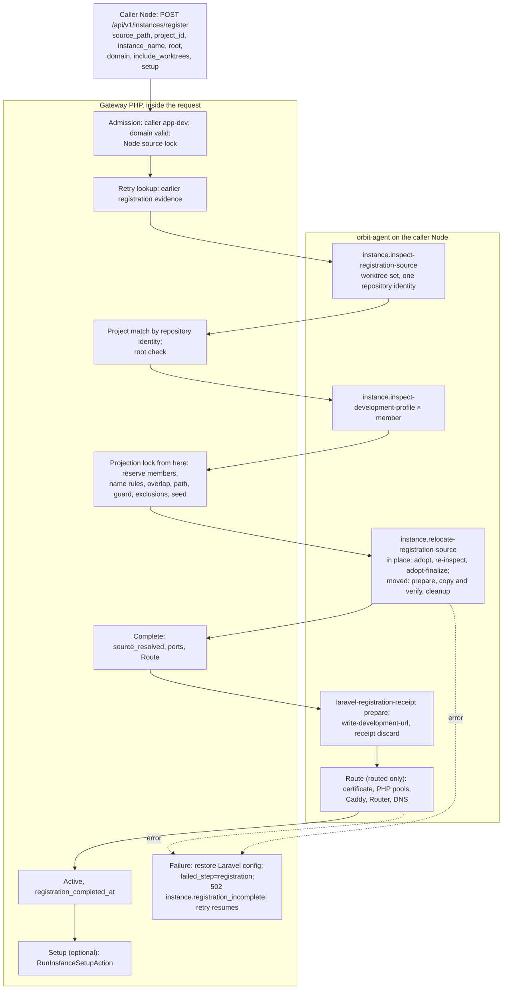
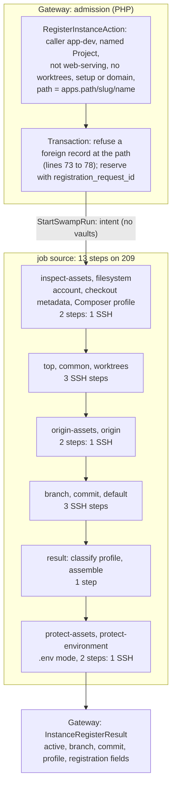

# Instance register: legacy and Swamp flows

Legacy `instance:register` adopted an existing Git checkout as a managed Instance inside one API request. It handled routed Laravel apps, worktree sets, moved checkouts and an optional setup run. A typical in-place adoption made about 8 agent calls; the longest recorded run took 522 s. On main, register accepts one case only. The Project must not serve the web, and its checkout must already sit at `<apps.path>/<slug>/<name>`. It runs 13 steps on Node 209. Operation 5995, on an earlier shape, hung for 55 minutes without a recorded step. This page is the map for the F9 rebuild of `instance.register`.

Sources:

- Legacy: `RegisterInstanceAction` at [`4603475a4c`](https://github.com/hardimpactdev/orbit/tree/4603475a4c), the last fully legacy commit.
- First switch: `3c897e768a` (#1616, 29 October) made register an Operation whose steps still called the agent.
- Second switch: `30f953335b` (#1910, 31 October) moved it to one native root and deleted the agent registration commands. Its Swamp half is orbit-swamp#368.
- #2238 (`2c4cad46b5`, 1 November) moved it to SSH from Node 209.
- Swamp: [`workflow-operation-instance-register.yaml`](https://github.com/hardimpactdev/orbit/blob/main/swamp/workflows/workflow-operation-instance-register.yaml) on main.
- Runs: Gateway Operation records and ADR 0218.

## Legacy flow

`POST /api/v1/instances/register` called `RegisterInstanceAction` inside the request and returned the Instance. The calling Node was the source Node. Each Node action was one orbit-agent command over SSH. The Gateway held the Node's source lock and, around reservation and completion, the projection lock.

| Phase | Legacy action | Actor | File at `4603475a4c` |
| --- | --- | --- | --- |
| Admission | Caller placement, domain, locks, retry lookup | Gateway | `apps/gateway/app/Actions/Instances/RegisterInstanceAction.php` (`assertPlacement`, `retainedMember`) |
| Inspect | Worktree set and repository identity | agent | `Infrastructure/Instances/RemoteRegistrationSourceManager.php` (`inspect-registration-source`) |
| Project | Match by repository identity; root | Gateway | `RegisterInstanceAction::resolveProject` |
| Profile | Composer facts per member, including a nested root | agent | `RegisterInstanceAction::preflightSources` (`inspect-development-profile`) |
| Reserve | Name and default rules, overlap, path, destination guard, exclusions, seed | Gateway | `RegisterInstanceAction::reserveMembers` |
| Relocate | Adopt in place, or move with copy, verify and worktree link repair | agent | `RemoteRegistrationSourceManager.php` (`relocate-registration-source`) |
| Complete | Laravel URL with a rollback receipt; Route publication | agent + Gateway | `RegisterInstanceAction::completeMember`, `NativeDevelopmentRouteProjector.php` |
| Setup | Optional setup list in the same request | Gateway + agent | `RunInstanceSetupAction` |

Gateway paths are under `apps/gateway/app/`. Register imported no environment: its only `.env` effects were the URL write, its rollback receipt and closing the file mode. An in-place, unrouted adoption made about 8 agent calls. A routed one made about 14 to 17, plus Router work and one call per setup step. ADR 0218 recorded 522 s as the longest `instance:register`.

Legacy tests for the parity port, at `4603475a4c`: `apps/gateway/tests/Feature/Api/InstanceRegistrationTest.php` (30), `apps/gateway/tests/Feature/Infrastructure/Instances/RemoteRegistrationSourceManagerTest.php` (17), agent `apps/agent/src/commands/registration_tests.rs` (25), CLI `NativeGitRegistrationDiscoveryTest.php` (2), plus register cases in `InstanceSourceConsentTest.php` (2), `InstanceCommandsTest.php` (5), the PHP SDK `InstanceRequestsTest.php` (4) and `CommandActivityTest.php` (1).

## Swamp flow on main

`RegisterInstanceAction` admits the registration. On main it accepts a narrow case only. It refuses with `operation.kind_unavailable` when there is no named Project, when worktrees, setup or a domain are requested, or when the Project type serves the web (`laravel-app`, `symfony-app`). It also refuses a source path other than `<apps.path>/<project-slug>/<name>` on the calling Node. The caller must be an active Linux app-dev Node. Its configured account must not be `root`. In one transaction, the action reserves the Instance with a `registration_request_id`, then starts the run. The run has one job of 13 steps on Node 209. Nine of them reach the calling Node over `@swamp/ssh`.

Each step depends on the previous one succeeding. No step has a guard, a timeout or a `forEach`. The run reads no vault and calls no Gateway endpoint. The Gateway projects the result from `job source, step result` when the run ends.

## Mapping

Legacy action to Swamp steps on main.

| Phase | Legacy calls | Swamp on main | Steps | Change |
| --- | --- | --- | --- | --- |
| Admission | Gateway + locks | `RegisterInstanceAction`, one transaction, no locks | 0 | Project inference, web Projects, worktrees, setup and domain **dropped** |
| Inspect | 1 agent call | `inspect-assets`, `filesystem`, `top`, `common`, `worktrees` | 5 | **1 → 5**; one plain checkout only |
| Origin | inside inspect | `origin-assets`, `origin` | 2 | |
| Profile | 1 call per member | inside `filesystem` and `result` | 0 | |
| Branch and commit | inside inspect | `branch`, `commit`, `default` | 3 | |
| Relocate | 3 calls in place; move path | none: the path must already be `<apps.path>/<slug>/<name>` | 0 | **move dropped** |
| Complete | receipt, URL, Route calls | `result`, then `InstanceRegisterResult` | 1 | URL write and Route **dropped** |
| Close `.env` | inside adopt-finalize | `protect-assets`, `protect-environment` | 2 | |
| Setup | optional, in the request | refused | 0 | **dropped** |

Totals: legacy about 8 agent calls for an in-place unrouted adoption. Main declares 13 steps, 9 of them SSH, for the one case it accepts.

## Why register refuses a failed create record

Lines 73 to 78 of `RegisterInstanceAction` look for an Instance at the same Node and checkout path. They refuse it with `instance.registration_conflict` (409, "The checkout already belongs to another Instance intent.") when any of these holds:

- it belongs to another Project or has another name;
- `registration_request_id` is null;
- it has a Route;
- its root differs;
- its status is not `reserved` or `active`.

A failed create never sets `registration_request_id`, so register always refuses its record. That is why register refused Instances 780 and 781 today. A `source_resolved` status or a create Route trips the same check. The refusal happens before any row, Operation or Node call.

The rule follows from who owns recovery. A failed native create keeps its Instance and source and records `failed_step` and `error_code`. An identical create retries after the failed run ends, and Instance removal clears an abandoned reservation (`docs/domains/applications.md`). Only create's own preparation receipt proves that it owns the checkout, so another command cannot claim it.

Legacy register never adopted a create record either. A create record had no registration evidence, so legacy treated the request as new and refused it at the overlap check with `instance.source_conflict` (test: "refuses to adopt an Instance already owned through instance new"). Between #1700 and #1910 (30 to 31 October), register could adopt the record of a failed create. #1910 removed it and deleted the documentation sentence that allowed it. No ADR records the rule, and no test on main covers lines 73 to 78.

For 780 and 781 the supported recoveries are an identical `instance:create` once the fixes it needs are live, or `instance:destroy` followed by a fresh create.

## Times and failures

Six registrations have run since the first switch.

| Operation | Shape | Target | Result | Time |
| --- | --- | --- | --- | --- |
| 5995 | #1910 / orbit-swamp#368 | Instance 779, `monorepo`, `/fast/apps/orbit/lane9-native-canary` | `operation.native_failed`, no step, result `[]` | 55 min 15 s |
| 5895 | same | Instance 777 | succeeded | 1 s |
| 4525, 4508 | #1616 Operation with agent steps | Instances 772, 771 | succeeded | 1 min 17 s, 2 min 5 s |
| 4340, 4330 | same | Instances 770, 768 | cancelled | 22 min, 17 min |

Operation 5995 ran the #368 shape on the caller Node's worker. It had two jobs: `register`, with one TypeScript behavior step `@nckrtl/instance-register.execute`, and a `native-failure` job that reported a failed `register`.

The one step inspected the checkout and projected the result to the Gateway. A hang inside it leaves no finer step to record. When the step finally failed, the reporter job recorded `operation.native_failed`, 55 minutes after the start. #2152 removed the reporter job on 1 November. No lane note records the cause. Main splits the work into 13 steps, but none sets a timeout and the workflow sets no queue timeout, so a hung SSH command can still hold a run.

No registration has run on the #2238 shape.

## F9 rebuild phases

Legacy is the spec (PLAN F9). Each phase becomes one script file run as one step, in this order. Edge cases are the ones the legacy handled.

### 1. Admit (Gateway)

Runs on: Gateway, with the Node source lock.

- Caller is an active Linux app-dev Node (`instance.caller_not_app_dev`).
- Domain is valid; domain intent survives retries; an unfinished domain change is refused.
- Retry lookup: an identical retry resumes; a conflicting retry returns 409.
- Main refuses a record owned by create here (`instance.registration_conflict`); legacy refused it at reserve, phase 5.

### 2. Inspect source

Runs on: caller Node.

- Refuse a non-Git source or a worktree set with mixed repository identities before any change.
- List the worktree set when `include_worktrees` is on.

### 3. Match Project (Gateway)

Runs on: Gateway.

- Infer the Project by repository identity; name the error for several matches, an explicit mismatch, or none (point to `project:create`).
- Validate the root override (`project.root_invalid`).

### 4. Profile

Runs on: caller Node.

- Read Composer facts for each member's application directory, including a nested root.

### 5. Reserve (Gateway)

Runs on: Gateway; the projection lock covers phases 5 to 7.

- Name rules: a slug directory on the default branch becomes `default`; a name equal to the default branch converts and reports `name_converted_from`; `instance.identity_conflict`, `instance.name_invalid`.
- A source nested in or owned by another Instance, including a record owned by create; overlap (`instance.source_conflict`); taken path (`instance.path_taken`); destination guard; Node exclusions.
- Seed selection tied to the adopted commit.

### 6. Adopt or relocate

Runs on: caller Node.

- In place: adopt, re-inspect, finalize.
- Moved: copy across filesystems and verify, repair worktree links, and close `.env`.
- Recover from each relocation state by device and inode identity, including a move that outran its checkpoint.

### 7. Complete

Runs on: caller Node, Router, DNS owner.

- Laravel `.env` URL with a rollback receipt: prepare, restore on failure, discard on success.
- Close the `.env` file mode.
- Route publication for web-serving Projects; a retry after completion republishes without downgrading the Instance.

### 8. Setup (optional)

Runs on: caller Node.

- Run the Project setup list; a failure keeps the Instance with `failed_step=setup`.

### 9. Finish (Gateway projection)

Runs on: Gateway.

- Active and `registration_completed_at` on success.
- On failure, record `failed_step=registration` and keep the record for an identical retry (`instance.registration_incomplete`).

Budget (PLAN F8): the legacy request took at most 522 s, including setup. Each phase from 2 to 8 fits one SSH call to one Node, and each needs a step timeout.
