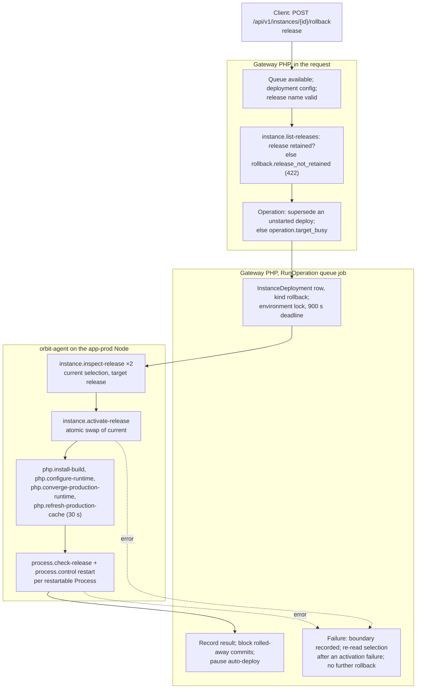
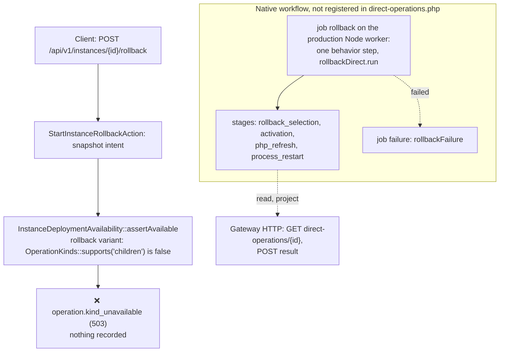

# Instance rollback: legacy and Swamp flows

Legacy `instance:rollback` selected a retained production release from one queued job. It made about 8 agent calls plus 2 per restarted Process, under a 900 s deadline. On main the Gateway refuses every production rollback at admission with `operation.kind_unavailable`, before it writes anything. A native workflow exists, but the Gateway does not register it, and the rollback API test is skipped as "Deferred". No rollback has run on a Swamp shape. This page is the map for the F9 rebuild of `instance.rollback`.

Sources:

- Legacy: `RollbackInstanceAction` and `InstanceRollbackOperation` at [`d65c5995de`](https://github.com/hardimpactdev/orbit/tree/d65c5995de). The queued shape dates from #1301 (ADR 0209).
- Switch: `7be1afa8e7` (#1590, 29 October) made rollback a Kit kind that still called the agent commands. #1894 (`0c661a2b5d`, 31 October) removed Kit and added no direct entry for rollback.
- Swamp: orbit-swamp#437 (`2f27cdcb49`, 31 October) added [`workflow-operation-instance-rollback-direct.yaml`](https://github.com/hardimpactdev/orbit/blob/main/swamp/workflows/workflow-operation-instance-rollback-direct.yaml) and `rollback_direct.ts`. #2144 skipped `InstanceRollbackOperationTest`.

## Legacy flow

`POST /api/v1/instances/{instance}/rollback` with `{"release"}` admitted an `instance.rollback` Operation and answered `202`. A `RunOperation` job on the `operations` queue ran it. Each Node action was one orbit-agent command over SSH. The job held the Instance environment lock and a 900 s deadline.



| Phase | Legacy action | Actor | File at `d65c5995de` |
| --- | --- | --- | --- |
| Admission | Queue, config, retained release, supersede or refuse | Gateway + agent | `apps/gateway/app/Actions/Instances/StartInstanceRollbackAction.php`, `Domain/Operations/OperationStore.php` |
| Selection | Read the current and target releases | agent, 2 calls | `RollbackInstanceAction.php`, `Infrastructure/Instances/RemoteProductionDeployment.php` |
| Activation | Swap `current`; the receipt must match; update `checkout_path` | agent, 1 call | `RollbackInstanceAction.php` |
| PHP refresh | Build, configure, converge and refresh the FPM runtime (only with a PHP version) | agent, 4 calls | `Infrastructure/Instances/RemoteProductionPhpRuntimeManager.php` |
| Processes | Check the release and restart each restartable Process | agent, 2 per Process | `RestartInstanceProcessesAction.php`, `RemoteProcessRuntimeManager.php` |
| History | Deployment row, rolled-away block, auto-deploy pause | Gateway | `InstanceDeploymentRecorder.php`, `AutomaticDeployHistory.php` |

Gateway paths are under `apps/gateway/app/`. Steps resumed after a lost worker; after 3 attempts the run ended with `operation.worker_lost`. A cancel stopped the run only before activation. No measured rollback time is recorded; the deadline was 900 s.

Legacy tests for the parity port, at `d65c5995de` under `apps/gateway/tests/Feature/`: `Api/InstanceRollbackOperationTest.php` (17), the rollback cases in `Domain/DeployInstanceTest.php` (about 8 of 27), `Domain/Operations/OperationRecoveryTest.php` (2), `Api/InstanceSmokeRecoveryTest.php` (10, deleted in #2144) and cases in `InstanceDeploymentHistoryTest.php` and `AutomaticDeployPolicyContractsTest.php`. Agent side: `production_tests.rs` (16) and `production_home_tests.rs` (14).

## Swamp flow on main

The diagram shows where a production rollback stops on main, and the native workflow the Gateway does not start.



`StartInstanceRollbackAction` snapshots the deployment intent, then calls `InstanceDeploymentAvailability::assertAvailable`. For a production Instance that check throws `operation.kind_unavailable`, because `OperationKinds::supports('children')` returns false since Kit was removed. The smoke-driven rollback (`InstanceSmokeRecoveryAction`, `InstanceSmokeControlAction`) calls the same check and stops there too. A development Instance stops earlier: the rollback intent snapshot resolves the deployment config, which throws `deployment_config.unavailable` (409) for an Instance that is not on app-prod.

If the Gateway registered the workflow, it would run as two jobs on the production Node's own worker, not on 209. Job `rollback` holds one TypeScript behavior step. It reads the Operation from the Gateway, projects `running`, then runs four stages locally: two release inspections, the `current` swap, the PHP refresh, and the Process restarts. It never guesses a selection: a failed read-back sets `selection_confirmed: false`. Two inputs do not line up: admission records only `{instance_id, release, deployment}`, while the behavior also requires `php_input` and `runtime_definitions`. The smoke input has no top-level `release`.

## Mapping

Legacy call to Swamp steps. The Swamp side is the unregistered workflow.

| Phase | Legacy calls | Swamp on main | Steps |
| --- | --- | --- | --- |
| Admission | Gateway + `list-releases` | refused at `assertAvailable` | 0 |
| Selection | 2 agent calls | `rollback` behavior, stage `rollback_selection` (unregistered) | 1 step for all four stages |
| Activation | 1 agent call | stage `activation` | (same step) |
| PHP refresh | 4 agent calls | stage `php_refresh` | (same step) |
| Processes | 2 per Process | stage `process_restart` | (same step) |
| History and blocks | Gateway | `InstanceDeployProjection::apply`, `recordNative` | 0 |
| Failure | job records the boundary | job `failure`: `rollbackFailure` | 1 |

## Times and failures

No `instance.rollback` Operation exists, on any shape. Admission refuses every production rollback before it records one. The legacy kind left no measured run time in the docs or ADRs.

## F9 rebuild phases

Legacy is the spec (PLAN F9). Each phase becomes one script file run as one step, in this order. Edge cases are the ones the legacy handled.

### 1. Admit (Gateway)

Runs on: Gateway, plus one release listing on the production Node.

- Refuse an unsafe release name before any Node call.
- Refuse a development or unconfigured Instance (`deployment_config.unavailable`).
- Refuse a release the Instance does not retain (`rollback.release_not_retained`, 422) before writing anything, so a queued deploy stays untouched.
- Supersede a queued deploy that no worker started (`operation.superseded`); refuse any other holder (`operation.target_busy`).

### 2. Select

Runs on: production Node.

- Read the current selection and the target release.
- Refuse a release pruned after admission (`rollback.release_invalid`) and a repository mismatch (`deployment.repository_mismatch`, `deployment.repository_rebind_required`).

### 3. Activate

Runs on: production Node.

- Swap `current` atomically; the receipt name and commit must match.
- After a failed or unconfirmed swap, read the selection again and record it; never guess.
- Before activation a cancel ends the run (`deployment.cancelled`); after activation cancels are ignored.

### 4. Refresh PHP

Runs on: production Node, only with a PHP version.

- Build, configure and converge the FPM runtime, then refresh OPcache within 30 s.
- Codes: `app-prod.php_cache_socket_unavailable`, `app-prod.php_cache_association_invalid`, `app-prod.php_cache_reset_rejected`, `app-prod.php_cache_reset_pending`, and `app-prod.php_cache_refresh_failed` for any other refresh failure.

### 5. Restart Processes

Runs on: production Node.

- Check the release and restart each active, running Process with `restart_on_deploy`.
- A restart failure fails at `after_activation`. The release that the rollback selected stays selected.

### 6. Record (Gateway projection)

Runs on: Gateway.

- One deployment row of kind `rollback` with release, commit, status, `failed_step` and `error_code`.
- In the same transaction, block the rolled-away commits and pause auto-deploy, whatever the outcome.
- Smoke rollback checks its guard before effects and again after activation (`instance.smoke_rollback_invalid`, `instance.smoke_selection_changed`, `instance.smoke_rollback_target_missing`).

Budget (PLAN F8): the legacy deadline was 900 s; the PHP cache refresh had 30 s.

## Draft F13 fixture

A draft in the frozen F13 request format (`swamp-proof-fixture-v0.md`). The topology needs an app-dev Node for the candidate and an app-prod Node with a TLD. Two deploys of the same branch give two retained releases; the request rolls back to the first. `--json` on an Operation command prints the final Operation, so `$.result.release` holds each deploy's release name.

```json
{
  "kind": "instance.rollback",
  "workflow": "operation-instance-rollback-direct",
  "topology": "app-prod",
  "budget_seconds": 900,
  "prepare": [
    {"argv": ["orbit", "project:create", "proof-rb-${proof.run}", "laravel-package", "${proof.repo.url}", "--json"],
     "capture": {"project_id": "$.id"}},
    {"argv": ["orbit", "instance:create", "${capture.project_id}", "${topology.app-dev.node_id}", "default", "--json"],
     "capture": {"candidate_id": "$.target_id"}},
    {"argv": ["orbit", "instance:clone", "${capture.candidate_id}", "${topology.app-prod.node_id}", "prod", "--preview-name=proof-${proof.run}", "--json"],
     "capture": {"production_id": "$.target_id"}},
    {"argv": ["orbit", "instance:deploy", "${capture.production_id}", "--json"],
     "capture": {"release_a": "$.result.release"}},
    {"argv": ["orbit", "instance:deploy", "${capture.production_id}", "--json"],
     "capture": {"release_b": "$.result.release"}}
  ],
  "request": {
    "argv": ["orbit", "instance:rollback", "${capture.production_id}", "--release=${capture.release_a}", "--json"],
    "operation": "$.id"
  },
  "expect": {"status": "succeeded", "outputs": {"job": "rollback", "step": "rollback", "match": {"status": "succeeded"}}}
}
```

The parity check reads the Operation with `operation:show` and requires `result.selected_release` to equal `${capture.release_a}`.

Gaps the fixture exposes:

- **Request:** main refuses it at admission with `operation.kind_unavailable`, so the proof fails until the rebuild registers rollback.
- **Prepare:** `instance:clone` on main refuses a production target (see the clone map). No production Instance can be built through the CLI.
- **Order:** the clone rebuild must land first, or the topology image must carry a production Instance.
- **Project type:** native create refuses web-serving Projects, so the draft uses `laravel-package`.
- **Coverage:** a proof of the PHP-FPM refresh and a Route needs a `laravel-app`. It waits on the create and clone rebuilds.
- **Topology:** the `app-prod` topology must include an app-dev Node for the candidate.
