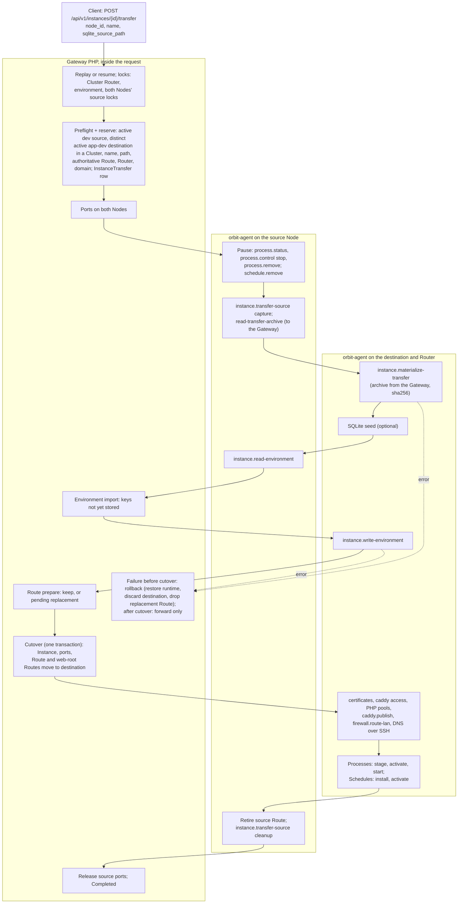
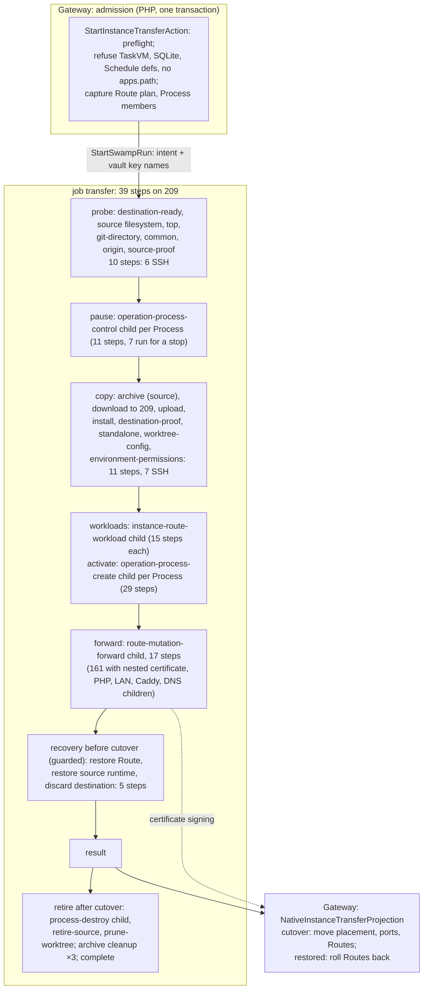

# Instance transfer: legacy and Swamp flows

Legacy `instance:transfer` moved an active development Instance to another app-dev Node inside one API request. It made about 25 to 35 agent calls for an Instance with one Route and one Process. On main, transfer runs 39 parent steps on Node 209. Eight of them start child workflows. The Route move child alone declares 17 steps and starts nested Route children; counted once each, they declare 161 steps. No transfer has run since the switch. This page is the map for the F9 rebuild of `instance.transfer`.

Sources:

- Legacy: `TransferInstanceAction` at [`3c897e768a`](https://github.com/hardimpactdev/orbit/tree/3c897e768a). Transfer files are the same at its parent `4603475a4c`.
- First switch: `6b71cd0168` (#1598, 29 October) deleted the executor and admitted an Operation, but admission refused with `operation.kind_unavailable` until an archive relay existed.
- Second switch: `6a6d46ead7` (#1965, 31 October) ran transfer as one native DAG. #2238 (`2c4cad46b5`, 1 November) moved it to SSH from Node 209.
- Swamp: [`workflow-operation-instance-transfer.yaml`](https://github.com/hardimpactdev/orbit/blob/main/swamp/workflows/workflow-operation-instance-transfer.yaml) on main.

## Legacy flow

`POST /api/v1/instances/{instance}/transfer` called `TransferInstanceAction` inside the request and answered `201`, or `200` for a resume or replay. The CLI asked for consent, or took `--force`, before it sent the request. Each Node action was one orbit-agent command over SSH. An `InstanceTransfer` row recorded each checkpoint, so an identical request resumed where the last one stopped.



| Phase | Legacy action | Actor | File at `3c897e768a` |
| --- | --- | --- | --- |
| Admission | Replay, locks, preflight, reserve the transfer row | Gateway | `apps/gateway/app/Actions/Instances/TransferInstanceAction.php` (`existingTransfer`, `reserve`) |
| Pause | Stop and remove source Processes, remove Schedules | agent | `NativeInstanceTransferRuntime::pause` |
| Copy | Capture the source; stream the archive through the Gateway; materialize on the destination | agent + Gateway | `Infrastructure/Instances/RemoteInstanceTransferSource.php`; agent `transfer_source.rs` |
| SQLite | Seed the snapshot (optional) | agent | `RemoteInstanceSqliteSeeder`, `ProtectedSqliteSnapshotTransfer` |
| Environment | Import missing keys from the source `.env`; write the destination `.env` | agent + Gateway | `TransferInstanceAction` (import and rebuild) |
| Route | Keep the Route or create a pending replacement | Gateway | `TransferInstanceAction` (route prepare) |
| Cutover | Move placement, ports and Routes in one transaction | Gateway | `TransferInstanceAction` (cutover) |
| Activate | Relocate Process and Schedule records; certificates; Route projection; start runtime | agent + Gateway | `NativeDevelopmentRouteProjector.php`, `NativeInstanceTransferRuntime::activate` |
| Retire | Retire the source Route and clean up the source checkout | agent | `NativeDevelopmentRouteProjector` (`retireSource`), `instance.transfer-source cleanup` |

Gateway paths are under `apps/gateway/app/`; agent paths are under `apps/agent/src/commands/`. With one Route, one Process, no SQLite and a separate Router, a transfer made about 25 to 35 agent calls. No duration is documented.

Legacy tests for the parity port, at `3c897e768a` (71 Pest and 16 Rust tests):

| File | Tests |
| --- | --- |
| `apps/gateway/tests/Feature/Domain/TransferInstanceTest.php` | 42 |
| `apps/gateway/tests/Feature/Api/TransferInstanceTest.php` | 11 |
| `apps/gateway/tests/Feature/Infrastructure/Instances/RemoteInstanceTransferSourceTest.php` | 4 |
| `apps/gateway/tests/Feature/Infrastructure/Instances/ProtectedSqliteSnapshotTransferTest.php` | 2 |
| `apps/cli/tests/Feature/Instances/TransferInstanceCommandTest.php` | 8 |
| `packages/php-sdk/tests/Unit/Requests/Instances/TransferInstanceRequestTest.php` | 4 |
| `apps/agent/src/commands/transfer_source_tests.rs` | 10 |
| `apps/agent/src/commands/sqlite_transfer_tests.rs` | 6 |

## Swamp flow on main

`StartInstanceTransferAction` runs the same preflight in one transaction and answers `202`. It refuses with `operation.kind_unavailable` (503) for a TaskVM source or destination, a SQLite path or a Project with Schedule definitions. A destination without a stored `apps.path` gets the same code with 409. It refuses an unknown source profile with `instance.source_profile_missing`. The run has one job of 39 steps on Node 209: 10 SSH steps reach the source, 8 reach the destination, and 8 start child workflows.



Guards and skips:

- Every step up to and including `forward` skips after the first failed step.
- Cutover means `forward` succeeded with `ready`.
- The recovery steps key on `forward` not being ready and on `destination-proof`.
- The retirement steps key on cutover and `result`.
- The three archive removals run whenever their archive step succeeded.

The archive:

- The archive travels source → 209 → destination over `@swamp/ssh` copies. In legacy it travelled through the Gateway.
- The archive holds the whole working tree, `.env` included, and the Git metadata.
- The archive refuses a checkout with alternates (`instance.transfer_source_invalid`), a main checkout that has linked worktrees (`instance.transfer_source_shared`) or a Git lock (`instance.source_busy`).
- A linked worktree source becomes an independent checkout: the common repository travels as `.git` with the worktree's `HEAD` and `index`; `prune-worktree` cleans up the source registration.

## Mapping

Legacy action to Swamp steps on main. Child steps are declared steps per item.

| Phase | Legacy calls | Swamp on main | Parent steps | Fan-out |
| --- | --- | --- | --- | --- |
| Admission | Gateway, in the request | `StartInstanceTransferAction`, one transaction | 0 | SQLite and Schedules **refused** |
| Probe | inside capture | 10 probe steps | 10 | new |
| Pause | 3 calls per Process + 1 per Schedule | `pause`: `operation-process-control` child | 1 | **3 → 7 child steps run** per Process (11 declared) |
| Copy | 3 calls | `archive-assets` … `environment-permissions` | 11 | **3 → 11** |
| SQLite | about 6 calls (optional) | refused | 0 | **dropped** |
| Environment | 2 calls + Gateway import and rebuild | `.env` travels inside the archive; `environment-permissions` closes its mode | 0 | store import and rebuild **dropped** |
| Route and workloads | about 10 calls + DNS | `workloads` child (15) + `forward` child (17, 161 with nested children) | 2 | **about 12 → up to 176** declared |
| Activate | 3 calls per Process + Schedules | `activate`: `operation-process-create` child | 1 | **3 → 29 declared** per Process (about 26 run on systemd) |
| Recovery | Gateway rollback before cutover | `restore`, `restore-source-runtime`, `discard-destination-runtime`, `discard-assets`, `discard` | 5 | |
| Retire | about 6 calls | `retire-runtime` child, `retire-source-assets`, `retire-source`, `prune-worktree` | 4 | |
| Finish | Gateway | `result`, 3 archive removals, `complete` | 5 | |

Totals: legacy about 25 to 35 agent calls for one Route and one Process. Main declares 39 parent steps (18 SSH, 8 child workflows). With nested children counted once each, the same Instance reaches over 250 declared steps; guards skip part of them.

## Times and failures

No `instance.transfer` Operation exists. The kind has never run, on any Swamp shape. The parent sets no step or queue timeout.

## F9 rebuild phases

Legacy is the spec (PLAN F9). Each phase becomes one script file run as one step, in this order. Edge cases are the ones the legacy handled.

### 1. Admit and reserve (Gateway)

Runs on: Gateway, with the Cluster Router, environment and both source locks.

Refusals before anything moves (the CLI asks for consent first, `instance.confirmation_required`):

- Source not active, removing, or production (`instance.lifecycle_conflict`, `instance.removal_conflict`, `instance.production_refused`).
- Same Node (`instance.same_node`); destination inactive, not app-dev, excluded or outside an active Cluster (`instance.node_inactive`, `instance.node_not_app_dev`, `instance.node_excluded`, `instance.standalone_unsupported`).
- Name identity (`instance.identity_conflict`); destination occupied, with a rename hint (`instance.destination_exists`); domain taken (`route.domain_conflict`).
- No authoritative Route, a replacement in progress, a web-root Route not ready, or a public web-root Route (`instance.transfer_public_web_root_route`).
- A Schedule target in use (`schedule.target_in_use`), checked again before cutover.

Retry rules:

- An identical completed request replays; changed input returns `instance.transfer_retry_conflict`.
- An identical retry first finishes an unfinished rollback.

### 2. Pause source runtime

Runs on: source Node.

- Assign Vite and SSR ports on both Nodes.
- Stop Docker Processes gracefully; keep a null working directory null; remove Schedules.

### 3. Capture and copy

Runs on: source, then destination.

- Disable Git hooks and fsmonitor during capture.
- A worktree source becomes an independent checkout; keep the common repository.
- Exclude the selected SQLite file and its `-wal` and `-shm` files from the archive.
- Verify the archive by sha256 with a 1 TiB bound; remove every staged copy afterwards.

### 4. SQLite seed (optional)

Runs on: source and destination.

- Codes: `sqlite.seed_preflight_failed`, `sqlite.seed_transfer_failed`, `sqlite.seed_failed`; an unconfirmed seed returns `instance.clone_sqlite_unconfirmed`.

### 5. Environment

Runs on: source, Gateway, destination.

- Import only keys not already stored and record them; a missing `.env` imports nothing; an unreadable `.env` refuses the transfer.
- Write the destination `.env`; an unconfirmed write returns `env.sync_unconfirmed`.

### 6. Prepare Route (Gateway)

Runs on: Gateway.

- Keep the Route for an explicit or unchanged generated domain; otherwise create a pending replacement.

### 7. Cutover (Gateway)

Runs on: Gateway, one transaction with row locks.

- Move the Instance, ports, name, path and Routes; set `cutover_at`. After this point, only forward recovery.

### 8. Activate destination

Runs on: destination, Router, DNS owner.

- Relocate Process working directories and environment files and the Schedule host.
- Certificates (Gateway signs), Caddy access, PHP pools, Caddy, LAN firewall, certificate check, DNS.
- Start Processes and Schedules.
- Move web-root Routes to the destination, also when activation fails.

### 9. Retire source

Runs on: source, Routers, DNS owner.

- Retire the source Route and clean up the source; a lost cleanup response is retried and confirmed.
- Only cleanup is retried once the destination is authoritative (`instance.transfer_cleanup_incomplete`); changed ownership returns `instance.transfer_cleanup_conflict`; an unknown source Router returns `instance.transfer_source_router_unknown`.

### 10. Recover before cutover

Runs on: both Nodes and the Gateway, only after a failure before phase 7.

- Abandon the SQLite seed, restore the source runtime, discard the destination, delete the replacement Route and remove imported keys. Record which parts stay incomplete (`instance.transfer_failed`).
- While a transfer is open, destroy and `route:destroy` refuse with `instance.transfer_incomplete`.

## Draft F13 fixture

A draft in the frozen F13 request format (`swamp-proof-fixture-v0.md`). It needs a topology with two app-dev Nodes in one active Cluster with a Router; none exists yet. The real CLI takes positional arguments, and `--json` on an Operation command prints the final Operation, so captures read `$.id`, `$.target_id` and `$.result`.

```json
{
  "kind": "instance.transfer",
  "workflow": "operation-instance-transfer",
  "topology": "app-dev-pair",
  "prepare": [
    {"argv": ["orbit", "project:create", "proof-tr-${proof.run}", "monorepo", "${proof.repo.url}", "--json"],
     "capture": {"project_id": "$.id"}},
    {"argv": ["orbit", "node:settings", "${topology.app-dev-2.node_id}", "--setting=apps.path:/srv/apps", "--json"]},
    {"argv": ["orbit", "instance:create", "${capture.project_id}", "${topology.app-dev.node_id}", "proof-${proof.run}", "--json"],
     "capture": {"instance_id": "$.target_id"}},
    {"argv": ["orbit", "route:create", "${capture.instance_id}", "proof-${proof.run}.${topology.tld}", "--json"],
     "capture": {"route_operation_id": "$.id"}}
  ],
  "request": {
    "argv": ["orbit", "instance:transfer", "${capture.instance_id}", "${topology.app-dev-2.node_id}", "--force", "--json"],
    "operation": "$.id"
  },
  "expect": {"status": "succeeded"}
}
```

Gaps the fixture exposes:

- **Topology:** `app-dev-pair` (two app-dev Nodes, one Cluster, a Router) is not in the F12 library yet.
- **Binding:** `${topology.tld}` is not an F13 binding; the Route domain needs it or a fixed proof TLD.
- **Route:** transfer needs an authoritative Route, but native create makes none and refuses web-serving Projects. The `route:create` step on a `monorepo` Instance is unverified on main.
- **Destination path:** the destination needs a stored `apps.path`; the topology should set it so the `node:settings` step can go.
