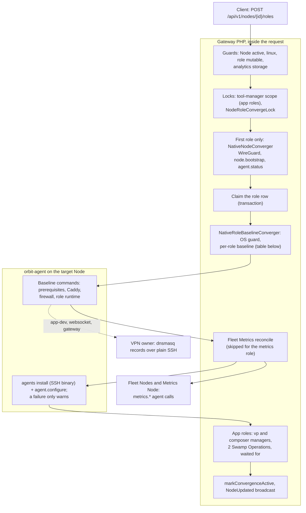
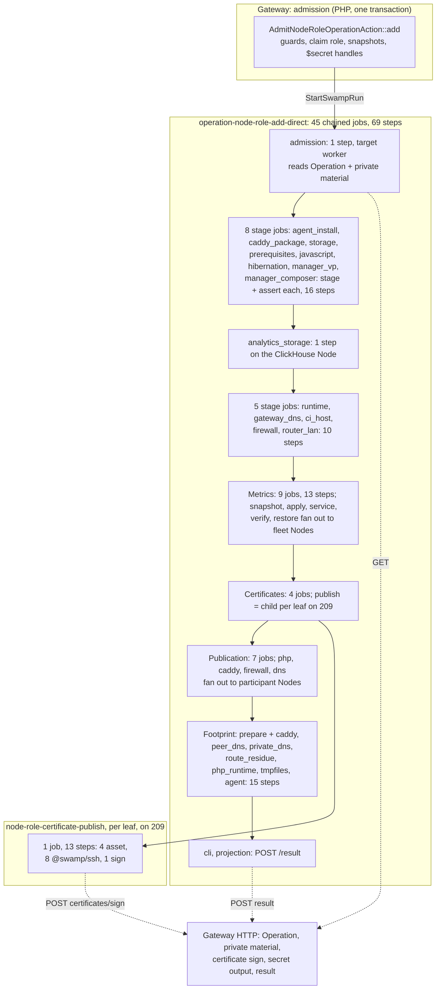
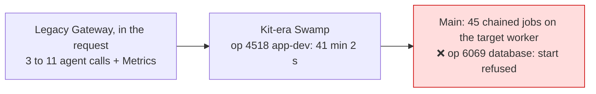

# Node role add: legacy and Swamp flows

The legacy Gateway added a role inside one API request. It sent each Node action as an orbit-agent command over SSH: about 3 calls for `database` and about 11 for `app-dev`, plus fleet Metrics calls. The Swamp port runs one root of 45 chained jobs and 69 steps on the target Node's own worker. Some jobs fan out to fleet Nodes, participant Nodes and Node 209. The only completed Swamp run, an `app-dev` add in the Kit era, took 41 min. This page is the map for the F9 rebuild of `node.role_add`.

Sources:

- Legacy: `AddNodeRoleAction` at [`73d8019056`](https://github.com/hardimpactdev/orbit/tree/73d8019056). It is the last commit before Kit removal (#1894), and the whole legacy path is intact there.
- Switch: `b289ef5ac2` (#1952, 31 October) moved role add to one native Swamp parent. Its Swamp half is orbit-swamp#418.
- Swamp: [`workflow-operation-node-role-add-direct.yaml`](https://github.com/hardimpactdev/orbit/blob/main/swamp/workflows/workflow-operation-node-role-add-direct.yaml) and [`workflow-node-role-certificate-publish.yaml`](https://github.com/hardimpactdev/orbit/blob/main/swamp/workflows/workflow-node-role-certificate-publish.yaml) on main.
- Runs: Gateway Operation records.

## Legacy flow

`POST /api/v1/nodes/{id}/roles` called `AddNodeRoleAction` inside the request. There was no queue job. The Gateway rendered configuration in PHP and sent it with agent commands. Private DNS was a plain SSH script on the VPN owner. The tool-manager step was the one exception: it started two Swamp Operations and waited for them.

Per-role baseline at `73d8019056`:

| Role | Agent calls on the target | Other effects | File under `apps/gateway/app/Infrastructure/` |
| --- | --- | --- | --- |
| `app-dev` | `node.prepare-storage-root`, `caddy.install-package`, `role.install-prerequisites`, `recipe.install-javascript`, `hibernation.prepare-directories`, `caddy.order-after-vpn`, `caddy.publish`, `firewall.rules`; about 11 | private DNS over SSH; 2 tool-manager Operations | `Nodes/Roles/DevelopmentRoleBaseline.php` |
| `app-prod` | prerequisites, Caddy order and publish, `firewall.rules` | 2 tool-manager Operations | `Nodes/Roles/ProductionRoleBaseline.php` |
| `database` | `role.install-prerequisites`; about 3 with agent install | WireGuard IP guard | `Nodes/Roles/DatabaseRoleBaseline.php` |
| `ingress` | prerequisites, Caddy order and publish; about 6 | no firewall on add | `Nodes/Roles/IngressRoleBaseline.php` |
| `ci-runner` | prerequisites, `ci-runner.host` converge, `firewall.rules`; about 5 | | `Nodes/Roles/CiRunnerRoleBaseline.php` |
| `websocket` | `caddy.check-addresses`, `websocket.converge-runtime`, certificate issue and publish, `caddy.publish`; about 7 | credentials in the Gateway, private DNS, rollback on failure | `Nodes/Roles/WebSocketRoleBaseline.php` |
| `metrics` | `metrics.credentials`, `metrics.runtime`, `metrics.cadvisor` | `metrics.node-exporter` on every fleet Node; certificate and Caddy site on the Gateway Node | `Nodes/Roles/MetricsRoleBaseline.php` |
| `analytics` | firewall, Plausible runtime | ClickHouse config on the ClickHouse Process's Node; publication on the Gateway | `Nodes/Roles/AnalyticsRoleBaseline.php` |
| `gateway` | Caddy package and order, firewall | access grants, private DNS, resolver route over plain SSH | `Nodes/Roles/GatewayRoleBaseline.php` |

Router and VPN were not mutable through role add. Each shared helper sat in one place: `RolePrerequisites`, `NodeCaddyBuilder`, `NativeNodeRoleFirewallManager` and `DnsmasqPrivateDnsManager`. A first role on a Node added at least 3 calls for the full Node converge.

Legacy tests for the parity port, at `73d8019056`:

| File | Tests |
| --- | --- |
| `apps/gateway/tests/Feature/Api/NodeRolesTest.php` | 58 |
| `apps/gateway/tests/Feature/Infrastructure/Nodes/NodeRoleBaselinesTest.php` | 32 |
| `apps/gateway/tests/Feature/Domain/AddNodeRoleActionTest.php` | 28 |
| `apps/gateway/tests/Feature/Domain/RelocateNodeRoleActionTest.php` | 21 |
| `apps/gateway/tests/Unit/Infrastructure/Metrics/MetricsRoleBaselineTest.php` | 14 |
| `apps/gateway/tests/Unit/Infrastructure/WebSocket/WebSocketRoleBaselineTest.php` | 11 |
| `apps/cli/tests/Feature/Nodes/AddNodeRoleCommandTest.php` | 16 |
| Five smaller baseline and Caddy files | 28 |

Later stages: #1652 added the admission action for enrollment children; #1920 moved analytics; #1952 switched role add; #1980 moved converge, remove and relocate; #2170 and #2190 added a converge path from 209 for Database and Ingress.

## Swamp flow on main

`AdmitNodeRoleOperationAction::add` checks the guards and claims the role in one transaction. It captures runtime, direct, publication, certificate and Metrics snapshots, the participant Nodes, and `$secret` handles for the agent secret hash, the role runtime material and the Metrics runtime. The root runs on the target Node's own worker (`orbit-node-<node_id>`), not on 209. It declares no vaults: workers read the Operation and its private material from the Gateway over HTTP.

Each stage job runs one local behavior and one assert. A stage that does not apply to the role is skipped by its guard. The stages run local sudo or Python programs on the worker (`role_direct_local.ts`), not orbit-agent commands.

Each job waits for the one before it to succeed, so one failure skips the rest of the chain. `cli` and `projection` depend on every job with `always`, so they still run and report the failure. The Metrics restore and complete jobs also run `always`, so a failed Metrics change is rolled back. `node.role_converge` with `--converge-existing` runs `operation-node-role-converge-209`. For a sole Database or Ingress role on a fleet without Metrics, it calls `node-role-converge` over `@swamp/ssh` from 209; otherwise it calls this root as a child.

## Mapping

Legacy action to Swamp jobs on main.

| Legacy action | Actor | Swamp on main | Jobs | Steps |
| --- | --- | --- | --- | --- |
| Guards, locks, claim | Gateway, in the request | admission transaction + `admission` job | 1 | 1 |
| First-role Node converge | Gateway + agent | not in this root; admission requires an enrolled Node with an agent secret hash | 0 | 0 |
| Agent install and configure | agent, 2 calls | `agent_install_job`, `agent_job` | 2 | 4 |
| Caddy package, order, publish | agent, 2 to 3 calls | `caddy_package_job`, `caddy_job` | 2 | 4 |
| Storage, prerequisites, JavaScript, hibernation | agent, 1 call each | 4 stage jobs | 4 | 8 |
| Tool managers | 2 Swamp Operations, waited for | `manager_vp_job`, `manager_composer_job` | 2 | 4 |
| Role runtime (ci-runner, websocket, metrics, analytics) | agent, 1 to 3 calls | `runtime_job`, `ci_host_job`, `analytics_storage_job` | 3 | 5 |
| Firewall | agent, 1 to 2 calls | `firewall_job`, `router_lan_job` | 2 | 4 |
| Private DNS, gateway DNS | plain SSH on the VPN owner | `gateway_dns_job`, `peer_dns_job`, `private_dns_job` | 3 | 6 |
| Metrics reconcile | agent calls per fleet Node | 9 Metrics jobs, fan-out per fleet Node | 9 | 13 |
| Certificates (websocket, metrics) | agent, 1 to 2 calls | 4 certificate jobs + a 13-step child per leaf on 209 | 4 | 4 + 13 per leaf |
| Route publication | inside Caddy and DNS calls | 7 publication jobs, fan-out per participant | 7 | 7 |
| Footprint residue | none | `prepare_footprint`, `route_residue`, `php_runtime`, `tmpfiles` | 4 | 7 |
| Finish | Gateway: mark active, broadcast | `cli`, `projection` + terminal projection | 2 | 2 |

Totals: a legacy `database` add made about 3 agent calls; Swamp runs all 45 jobs in order and skips the stages that do not apply. A legacy `app-dev` add made about 11 agent calls plus Metrics and DNS; Swamp adds Metrics fan-out to every fleet Node and certificate children on 209.

## Times and failures

Two role-add Operations ran around the port. Neither ran on the shape on main to completion.

| Operation | Role | Node | Shape | Result | Time |
| --- | --- | --- | --- | --- | --- |
| 4518 | `app-dev` | 211 | Kit-era admission (`_role_plan` input), 30 October, before #1952 | succeeded | 41 min 2 s |
| 6069 | `database` | 12 | main, 31 October | `swamp.start_refused`, before any step | 1 s |

The first run on main was refused before any step.

The root differs from the porting guide in three ways. It places steps on the target Node's worker instead of on 209 with `@swamp/ssh`. Its workers read intent and private material from the Gateway and post results over HTTP. Its 45 jobs run in a fixed chain, so a `database` add waits through every skipped stage.

The F9 rebuild should keep the legacy order: guards, prerequisites, Caddy, firewall, role runtime, DNS, Metrics, then finish. Each of those becomes one script step, with the per-role baseline as the spec.
